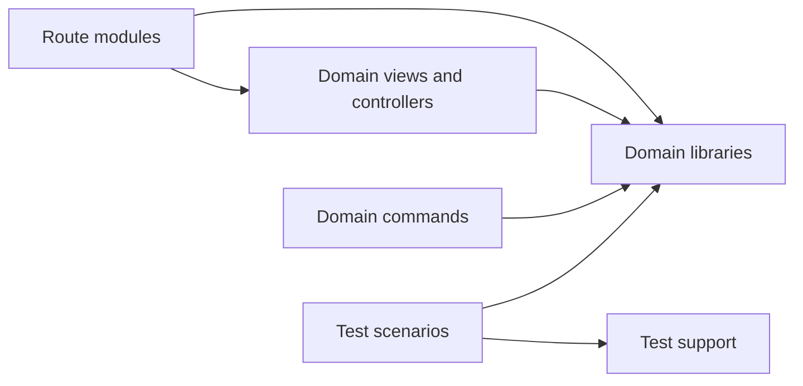
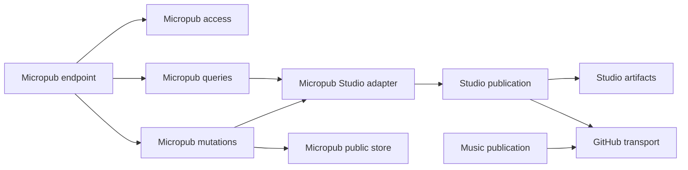

# Domain boundaries

Maintainers place code in the domain that owns its rules and keep dependencies
pointing toward those rules. Routes compose modules, views render domain state,
and libraries own parsing, decisions, and persistence. A library never imports a
route, UI component, command entrypoint, or test scenario.

## Roles and dependency direction

Use the same domain name across application, UI, commands, and tests. A writing
route belongs under `app/writings/`, its views under `components/writings/`, and
its source rules under `lib/writings/`. Framework-mandated filenames remain at
their required locations.

| Location                            | Ownership                                         |
| ----------------------------------- | ------------------------------------------------- |
| `app/`                              | Routes, metadata, and composition                 |
| `components/<domain>/`              | Views, hooks, and styles                          |
| `lib/<domain>/`                     | Contracts, transformations, loading, and storage  |
| `scripts/<domain>/`                 | Commands and their private helpers                |
| `tests/unit/<domain>/`              | Function and module contracts                     |
| `tests/integration/<domain>/`       | Modules using explicitly configured test services |
| `tests/e2e/site/<domain>/`          | Built-site browser behavior                       |
| `tests/support/`, `tests/fixtures/` | Shared test resources and inputs                  |

The component diagram shows import direction between module roles. Each node
represents a module group inside the application.

Keep a scenario's helpers beside it until another scenario needs them or they
manage a shared resource. Scenarios import support directly; support never
imports scenarios. Import command helpers from their owning module rather than
through an executable entrypoint. ESLint checks these directions for relative
imports and aliases.

## Shared foundations

`lib/site/identity.ts` owns public identity and deployment settings.
`lib/site/navigation.ts` owns top-level navigation and publication state.
`lib/site/urls.ts` owns URL classification and construction. `absoluteUrl`
resolves an address, `canonicalUrl` spells a canonical page address, and
`absoluteRoute` keeps interpolated routes on the canonical origin. Import the
owner directly instead of introducing a site-wide forwarding module.

`lib/http/` owns shared response behavior, `HttpError`, entity validators, and
byte-range parsing. `lib/github/client.ts` owns GitHub requests, optional reads,
upstream errors, and protected rebase merges. Its response contracts belong to
`lib/github/types.ts`. Studio and Music use this transport through the existing
`STUDIO_GITHUB_*` settings. `StudioError` remains an alias of the same `HttpError`
constructor for internal compatibility; it does not define another error model.

## Content and public reads

Writings, initiatives, and projects separate filesystem parsing in `load.ts`
from application access and publication filtering in `index.ts`. Commands read
loaders directly so build and editing operations see current files. Runtime
loaders use local files in Node and generated bundles in Workers.
`lib/content/runtime-files.ts` uses a generated directory index in Workers.
`lib/content` owns shared Markdown IO, date-derived status, and draft defaults;
each content domain owns its schema, reserved slugs, ordering, and visibility.

Collections separate file reading from series composition. Consumers import
`lib/collections` directly. Metadata lists skip document heading extraction.
React `cache` shares reads within a server render; it does not define cross-request
freshness. Link publication checks use path membership without constructing
hover-card display data. The [performance guide](../../guides/operations/performance.md)
defines measurement and cache ownership.

## Publishing and protocol boundaries

Protocol modules live under `lib/indieweb/<protocol>/`. Micropub's endpoint
orchestrates HTTP and CORS; access owns credentials and bearer challenges;
queries own configuration and authorized reads; mutations own create, update,
archive, and restore. Only `studio-adapter.ts` imports Studio's document schema,
store, and publisher. Private drafts never fall back to the public file backend.

The component diagram shows publishing modules. Studio and Music share GitHub
transport while retaining separate state transitions and persistence.

[Studio](../../reference/publishing/studio.md) owns editor/revision recovery.
[Music](../../reference/content/music.md) owns catalog preparation, draft recovery,
and playlist publication. Neither domain delegates its durable state to a shared
publication engine. A merge moves a job toward deployment; live verification
checks the deployed revision, source hash, and commit ancestry.

IndieAuth's endpoints own HTTP, the server module parses authorization and
produces metadata, grants own code/token issuance and rotation, and storage owns
SQL. AT Protocol separates OAuth SDK configuration, browser callback state, and
PDS record IO. [Protocol references](../../reference/publishing/indieweb.md) own
lifetimes, request formats, and storage requirements.

Public fetching separates address policy, socket transport, redirect validation,
and bounded body readers under `lib/indieweb/public-fetch/`. The entry module
composes them for documents and bytes. Node transport validates DNS at connection
time and checks the connected peer. Every redirect repeats address validation.
Workers use their public-network transport policy. Discarded streams are canceled;
body limits and POST redirect refusal apply before callers consume a result.

## UI lifetimes and contracts

State belongs to the lowest common owner that reads and changes it. Its lifetime
must preserve the user's work. Forms own fields, native file inputs, and local
errors; modal owners manage focus and dismissal; document owners keep revisions,
autosave, and recovery alive across task and preview navigation. Moving state
closer to a view must not reset a retained editor or file draft.

Controllers own request cancellation, stale-result rejection, progress, and
recovery. Views receive named domain contracts and the actions they need.
Successful background polling cannot clear an unrelated failed save. Keep labels,
pending feedback, errors, and undo behavior beside the action they describe.
Avoid flattening unrelated state and mutable refs into one controller result.

A producer declares the contract it owns; consumers import it. Prefer `Part`,
`Draft[]`, or `WritingDocument` over chains of `ReturnType`, `Awaited`, and
`NonNullable`. Keep utility types for real relationships such as native element
props, vendor adapters, and a small subset of a domain record. Next pages use
generated `PageProps<'/route'>`; handlers use `RouteContext<'/route'>`. Narrow
repeated query values at the boundary.

Stylesheet entrypoints preserve their import order because responsive and
accessibility overrides depend on the cascade. Extracting a view must preserve
DOM structure, focus, motion, and accessible names. Apply the
[design checklist](../design/design-principles.md#before-committing) and
[link contract](../../reference/design/links.md) to the rendered experience.

## Complexity and verification

Extract a module when one responsibility gains a useful name and small interface.
A forwarding wrapper or a conditional hidden behind a helper can add work for the
reader. Delete redundant branches and derived state before adding abstractions.
Passing a large controller through a small hook does not improve ownership.

ESLint limits cyclomatic complexity to 10, cognitive complexity to 15, and block
nesting to 4. UI functions also permit at most 150 nonblank, non-comment lines
and 30 statements. These limits expose review targets; they do not establish
sound design. Both lint commands reject warnings.

Use [testing](../../reference/operations/testing.md) to choose checks. Browser
review includes desktop and 390px viewports, both themes, keyboard use, reduced
motion, dialogs, and the unwrapped footer row. Local checks do not establish
provider or hosted acceptance. [Publishing verification](../../guides/publishing/publishing-verification.md)
defines the separate external gate.
