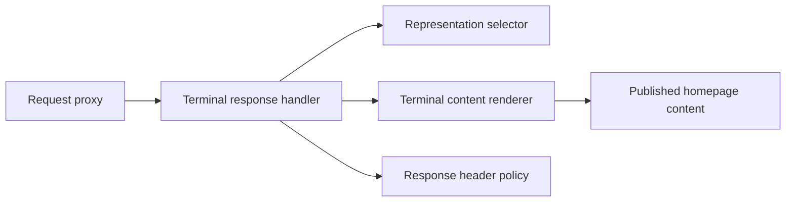

# Terminal homepage boundaries

Maintainers changing the terminal homepage should preserve the public content
boundary and request-selection rules. The HTTP handler decides whether it owns
the request. The selector chooses ANSI or plain text. The renderer turns existing
published homepage data into text. Keeping these responsibilities separate lets
a content change leave HTTP negotiation alone.

This component diagram shows dependencies between application modules:

The proxy authenticates private previews before considering public output.
The handler returns `undefined` for normal Next routing, including explicit HTML
overrides, query strings, and router requests. A terminal HEAD response selects
the same headers as GET without rendering the content.

The selector compares media-range specificity before comparing quality values.
For example, `text/plain;q=0, */*` excludes plain text even though the wildcard
accepts other types. An explicit HTML range wins a quality tie. Curl breaks the
remaining ties and receives ANSI unless the client explicitly asks for plain
text. The [protocol reference](../../reference/publishing/protocols.md#terminal-home)
defines the supported request headers and cache policy.

The renderer reads the public entry registry instead of assuming that every
affiliation in the site identity has a published detail view. Setting
`hidden: true` removes a venture from that registry. The terminal page omits
missing entries and empty work sections rather than dereferencing them. This
fixes the case where hiding Reasonable Tech Company left its identity affiliation
in place and made a curl GET throw a `TypeError`.

The renderer keeps a two-column margin inside a 72-column terminal. ANSI spans
use only bold emphasis and foreground colors, and each span resets its style.
Plain text contains the same content without those commands. Both formats use
the existing descriptions, so neither requires a second biography or provider
requests. The approved heading is `❖ WillieCubed`.

The [ANSI media-type compromise and Next header behavior](../../reference/publishing/protocols.md#terminal-home)
remain deliberate constraints. Local tests and captures do not establish
Cloudflare deployment behavior. Revisit the cache workaround if a later Next
version preserves the full HTML Vary header and the deployed host verifies it.
