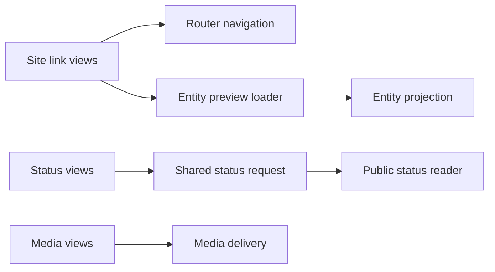

# Diagnose loading and repeated work

Maintainers compare the same build and browser conditions before changing a
loading path. Start with the affected route and an observable symptom, such as
extra JavaScript on `/music`, duplicate status requests, or a video downloading
before Play. Keep lab measurements, hosted responses, and provider usage
separate. One result cannot substitute for the others.

## Collect comparable measurements

Run these commands from the repository root with the locked dependencies:

```sh
pnpm build:metrics
pnpm preview:metrics
```

The build command writes `artifacts/cloudflare-build-metrics.json`; the preview
command writes `artifacts/cloudflare-preview-metrics.json`. These ignored
artifacts belong with the task or pull request that compares them. Retain the
revision, target, environment, and failures alongside each result. The
[metrics reference](../../reference/operations/build-metrics.md) owns field
meanings, sample counts, transfer categories, and private-target configuration.

Compare cold and warm visits separately. Inspect each sample's status and valid
count before comparing medians. A failed request, missing paint, or unavailable private route leaves a gap.
Inspect pending transfers and their recorded windows separately; known open RSC
streams can remain in a valid sample, but their bytes describe the observed
window rather than a completed response. Do not replace missing values with zero. Run the affected navigation journey as well as the destination's
full document load because the router can download different resources.
The collector discovers the initiative-detail destination from visible links on
`/initiatives`; `PREVIEW_METRICS_INITIATIVE_PATH` can select one explicitly.
If no published detail exists, the report stays partial with an unavailable
initiative result and expected 5/attempted 0/missing 5 counts. That absence does
not count as a pass or fail an otherwise valid run. A failed attempted
measurement still fails the command.

`PREVIEW_METRICS_BASE_URL` selects an already-running target. The default command
starts and stops its own local Worker preview. Private Studio measurements need
an explicitly selected authenticated fixture target. Follow the metrics
reference for private base URL, storage state, and headers. Do not use a private
login shell as proof that the editor loaded.

The isolated Studio harness can run this same analyzer with
`STUDIO_TEST_METRICS=1 pnpm test:studio`. It seeds Music fixtures, supplies the
signed private probe header, and selects `PREVIEW_METRICS_PRIVATE_ONLY=1`. Its
`scope: private` report leaves public route/journey maps empty. Collect public
production metrics separately. `STUDIO_TEST_PRODUCTION=1` selects `next start`
against the existing `.next` build instead of the default development server.
Use the [testing reference](../../reference/operations/testing.md#private-writing-and-music)
for prerequisites and cleanup. Inspect each target's outcome; a mode switch does
not establish private or public performance coverage.

A local preview excludes production network and edge conditions. For a hosted
issue, record the deployed revision, inspect real response headers and provider
logs, then compare fresh usage samples. Keep credentials and receipts outside
the repository.

## Find which owner repeats work

Use the browser Network panel to separate HTML, RSC, JavaScript, CSS, images,
JSON, and prefetch requests. The metrics report records these categories from
Chromium's encoded transfer events. Bundle output size and transferred bytes
measure different things; compare each against its own baseline.

The component diagram shows the public read owners. Each node is an application
module group; arrows show requests or calls.



For content lists, inspect whether the route needs document bodies or headings.
Writings and initiatives reuse source reads within one server render through
React `cache`; they retain current filesystem reads for build/editing commands.
Worker directory lookup uses the generated content index. A cross-request cache
is a separate policy with a freshness and invalidation owner.

### Navigation and hover previews

`SiteLink` owns in-site router navigation. Its `data-site-link` marker excludes
those links from the document speculation rule so two systems do not prefetch
the same destination. Speculation rules retain eligible native document links
and exclude protocol endpoints, feeds, actions, downloads, and nofollow links.
Next owns the router's RSC prefetch. Measure actual prefetch traffic before
changing either policy.

Hover cards request `/entities.json` only after mouse or visible keyboard intent.
A successful request is reused for the visit; failure clears the pending value
so later intent can retry. The server prepares brand schemes once per distinct
seed. The endpoint returns an ETag and handles conditional requests with 304.
A 304 still requires the server to construct the current representation for its
validator; it establishes reduced body transfer, not zero server work.
The [link reference](../../reference/design/links.md) owns preview timing and
interaction behavior.

### Status and provider data

Mounted status views share an in-flight `/api/status` request. Each owner keeps
its own refresh lifetime and abort signal. The shared request ends when its last
reader leaves, and the module retains no completed status snapshot. Inspect
multiple mounted/retained views when diagnosing duplicate reads. The
[status reference](../../reference/content/status.md) owns location caching,
weather freshness, and owner-save invalidation.

Approved Webmentions share a one-hour R2 snapshot across public pages and feeds.
Verified HTTP writes rotate its generation and invalidate the affected page.
Direct database moderation does not perform that invalidation and may take up
to an hour to appear. Without a usable R2 snapshot the reader queries storage.
The [Webmention reference](../../reference/publishing/webmention.md) owns those
visibility and moderation consequences. Hyperdrive query caching does not
replace application invalidation.

### Images, video, and byte delivery

Check the image's rendered size, source dimensions, selected `srcset` candidate,
and transfer bytes together. `next.config.ts` bounds optimizer widths and
qualities. Preview mode disables optimization because the optimizer does not
forward the owner's Access credentials. The shared `localImageSources` helper uses Next's `getImageProps` only for
dimensioned `/assets/` JPEG, PNG, WebP, and AVIF sources. Brand assets, remote
sources, protected media, and formats outside that allowlist keep their native source paths.
Remote posters bypass local optimization. An image's expected display size does not establish its actual
network transfer; inspect the selected response.

Native media keeps controls and `preload="none"`. The video component defers its HLS library import and manifest request until
Play intent. It retains native controls and the source link. Inspect manifest
and segment requests separately from the library download; pages without a video
must not download that playback code.
Check Play, source changes, failures, and unmount cleanup when changing this path.

Public R2 delivery validates the key and reads metadata before object bytes.
HEAD returns metadata without a body. Matching `If-None-Match` returns 304.
A satisfiable single byte range returns 206 with `Content-Range`; a valid but
unsatisfiable range returns 416. Unsupported range syntax falls back to a full
response. `If-Range` can require a complete representation.
The route streams the selected R2 body instead of buffering the whole object.
The [Micropub media reference](../../reference/publishing/micropub.md#public-delivery)
owns the HTTP details and upload/private-storage distinction.

## Verify the changed path

Run the focused unit contracts for the owner you changed, then repeat the
measurement that exposed the issue. For visual or interaction changes, capture
uncropped desktop and mobile viewports in both themes and inspect the affected
loading, error, and retry states. Check native links and media without scripts.

Report the measured behavior with its limits. Less JavaScript transfer does not
prove lower Worker CPU. A warm browser result does not prove an edge cache hit.
A local route gate does not prove real provider authorization. Use the
[deployment guide](deploy.md) and [publishing verification](../publishing/publishing-verification.md)
for the separate hosted gates.
