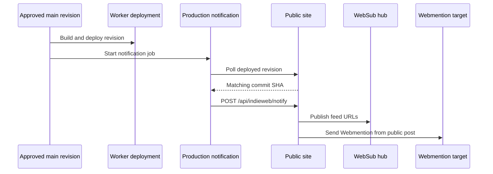

# Run the IndieWeb HTTP checks

Check route and markup changes locally, then select the affected external checks
from the [supported behavior contract](../../reference/publishing/indieweb-spec.md).
A local response, a deployed writing, and an outside subscriber's receipt answer
different questions. Keep disposable writings and databases outside production;
retain skipped or blocked cases alongside the passing ones.

The [verification guide](publishing-verification.md) describes what a hosted
Cloudflare publishing run must observe.
The [conformance record](../../reference/publishing/publishing-conformance.md)
links those dated results.

## Read-only checks

### Check the source and served markup

Run these from a configured checkout:

```sh
pnpm test
pnpm typecheck
pnpm lint
pnpm build
pnpm exec playwright test tests/e2e/site/indieweb/indieweb.spec.mts --project=desktop --workers=1
```

The browser suite inspects the served page after building it. Add
`pnpm build:cloudflare` or `pnpm build:cloudflare-preview` when the change affects
the corresponding Worker package. Build production and preview separately;
compiled origins and revisions prevent one output directory from representing
both environments.

### Choose hosted coverage deliberately

For a hosted read-only run, set `INDIEWEB_TEST_BASE_URL` to the selected origin
and `NEXT_PUBLIC_SITE_ORIGIN` to the identity it advertises. Set
`INDIEWEB_TEST_POST_PATH` to an approved disposable published writing to enable
the permalink/feed-item case. Without that path, the case skips; an empty feed
does not establish published-post behavior.

The private `preview.willie.page` surface is protected by Access. A public
validator that cannot authenticate cannot use it as a public acceptance origin.
Do not remove that protection to turn a draft preview into a test post. Establish
a separately approved, reachable fixture deployment when the check needs one.

## Isolated local write checks

### Prepare a disposable database and fixture

Local SQL now uses a direct PostgreSQL connection through `lib/db/postgres.ts`;
there is no Neon HTTP fetch shim. The server and test process must use the same
isolated URL. Confirm that `indieweb_acceptance` is disposable and that the
fixture path does not contain existing work before running these preparation
commands. They assume local PostgreSQL and a role allowed to create databases.

```sh
createdb indieweb_acceptance
export INDIEWEB_TEST_POSTGRES_URL=postgresql://localhost:5432/indieweb_acceptance
psql "$INDIEWEB_TEST_POSTGRES_URL" -v ON_ERROR_STOP=1 -f tests/fixtures/indieweb/webmentions.sql
psql "$INDIEWEB_TEST_POSTGRES_URL" -v ON_ERROR_STOP=1 -f lib/db/migrations/001_level4_tables.sql
psql "$INDIEWEB_TEST_POSTGRES_URL" -v ON_ERROR_STOP=1 -f lib/db/migrations/002_webmention_rate_limits.sql
psql "$INDIEWEB_TEST_POSTGRES_URL" -v ON_ERROR_STOP=1 -f lib/db/migrations/003_indieauth.sql
psql "$INDIEWEB_TEST_POSTGRES_URL" -v ON_ERROR_STOP=1 -f lib/db/migrations/004_webmention_responses.sql
psql "$INDIEWEB_TEST_POSTGRES_URL" -v ON_ERROR_STOP=1 -f lib/db/migrations/005_atproto_oauth.sql
psql "$INDIEWEB_TEST_POSTGRES_URL" -v ON_ERROR_STOP=1 -f lib/db/migrations/006_indieauth_refresh.sql
psql "$INDIEWEB_TEST_POSTGRES_URL" -v ON_ERROR_STOP=1 -f lib/db/migrations/007_micropub_deleted_archives.sql
psql "$INDIEWEB_TEST_POSTGRES_URL" -v ON_ERROR_STOP=1 -f lib/db/migrations/008_atproto_response_observations.sql
psql "$INDIEWEB_TEST_POSTGRES_URL" -v ON_ERROR_STOP=1 -f lib/db/migrations/009_indieauth_code_replay.sql
cp tests/fixtures/indieweb/publishing.mdx content/writings/indieweb-acceptance.mdx
pnpm build
```

These public publishing tables do not prepare private Studio drafts. Draft
creation requires its separate store and must not fall back to a checkout file.
The existing local suite creates a published compatibility note, so that test
cannot establish the private draft lifecycle.

### Account for the current harness limitation

`tests/e2e/site/indieweb/indieweb-write.spec.mts` creates its reply on a self-signed HTTPS
server at `127.0.0.1`. The Playwright configuration starts `next start`, a
production server, while the current public-fetch guard ignores
`INDIEWEB_TEST_ALLOW_LOOPBACK` whenever `NODE_ENV` is `production`. The old
loopback-and-TLS-bypass recipe therefore cannot establish a passing response
lifecycle with this harness unchanged.

Resolve the test harness's runtime and source-reachability mismatch before
claiming that full suite passes. Do not weaken the hosted public-address guard
or disable certificate verification on a hosted Worker. Unit fixtures remain
useful source checks, but they do not close this HTTP acceptance gap.

When exercising the local published-note path independently, set the server's
`POSTGRES_URL` to the same disposable URL as the test. Explicitly empty
`STUDIO_GITHUB_REPOSITORY` and `STUDIO_GITHUB_TOKEN`, and keep private Studio
configuration out of that file-backend test. Otherwise inherited configuration
can redirect writes to a remote branch or private store. Clear
`INDIEWEB_TEST_BASE_URL` and require a newly started server on an unused port;
the default Playwright configuration can reuse a server with different settings.

### Remove fixtures after diagnosis

The suite's normal cleanup removes its own note, token, Webmention, HTTPS source,
and certificate. Interruption can leave a partial result. Inspect the owned
source and database rows before treating cleanup as complete.

Remove only the fixture copied for this run, then rebuild before checking a
release. Keep the database until a failure is understood, and remove only the
disposable database you created. Neither a source-file assertion nor a seeded
local token proves a normal owner Access consent flow.

## Hosted publishing checks

### Establish the actual publication path

Select the isolated Worker, origin, publishing branch, public database,
private draft store if needed, and media bucket before writes. In Workers,
`HYPERDRIVE` serves publishing state and `MEDIA_BUCKET` serves Micropub uploads.
Private drafts use `STUDIO_HYPERDRIVE`, with no public source-store fallback.

GitHub publication uses `STUDIO_GITHUB_REPOSITORY`, `STUDIO_GITHUB_TOKEN`, and
`STUDIO_GITHUB_BRANCH`. Scope the token to `WillieCubed/website` with Contents
and Pull requests read/write. The protected merge enforces repository checks;
the current Worker does not require the old Checks/Commit-status read grants.
The [deployment guide](../operations/deploy.md) records current setup.

Follow the path being tested. A saved private revision is not yet a public file;
Studio publication must pass its selected-revision, review/merge, and deployment
stages. Existing published-file compatibility can commit directly through the
Contents API. Verify the resulting commit, deployed revision, permalink, feed
entry, and notification rather than manually rebuilding to conceal a missing
automatic deployment.

### Distinguish deployment from notification

Workers Builds deploys the selected repository revision. The current
`.github/workflows/indieweb-publish.yml` notifies production on `main` and manual
dispatch; it does not supply an isolated-branch notification job. An acceptance
run must establish its own authorized trigger.

The production order is:



A 202 accepts a source operation; it does not mean the public alias has deployed.
A notification result is also separate from actual hub subscriber delivery.

### Media and independent clients

Use the isolated media binding, upload through `/micropub/media`, and retain the
returned `/media/*` URL, source bytes, and ownership record. Create the photo
post with its URL and nonblank alt text. Check the 4 MiB/type/signature limits,
rendering, and deletion of only the owned R2 objects. A private R2 bucket still
serves these validated site URLs publicly; a private writing does not confer
privacy on an already uploaded Micropub media URL.

Use independent clients when their authentication and browser policy permit it.
Complete normal S256 IndieAuth consent through the current owner Access path;
a manually seeded token does not establish that authorization. Keep write cases
on the isolated publication path and revoke test credentials afterward. The
[September record](https://github.com/WillieCubed/website/blob/566f37b570df167f917f20217ee6fcd5131d12a8/docs/evidence/publishing/verification-2026-09-23.md)
describes earlier client results, not a fresh test of the migrated runtime.

## Retain results

Record the revision, date, origin, actual requests and outside observations,
skipped or blocked cases, and cleanup. The
[September follow-up](https://github.com/WillieCubed/website/blob/566f37b570df167f917f20217ee6fcd5131d12a8/docs/evidence/publishing/verification-2026-09-23-followup.md)
shows how isolated publication and fixes were recorded. Preserve the historical
provider and runtime in such evidence; a receipt from the earlier host does not
become Cloudflare acceptance because the same route now runs on a Worker.
