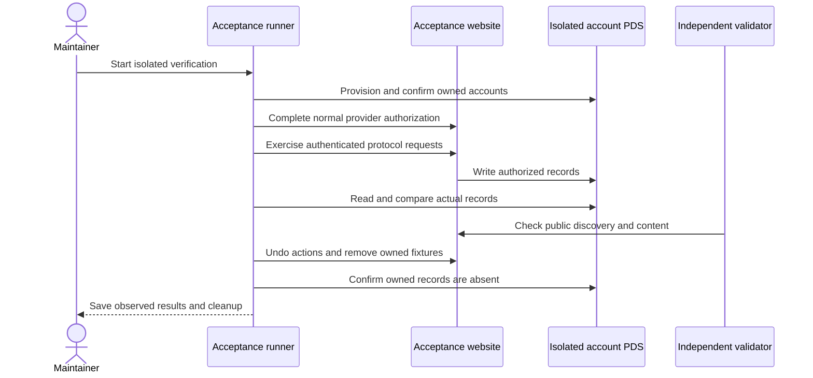

# Publishing verification

Verify a release by following an approved post from saved source through its
public deployment, outside records, responses, and subscriber delivery. Keep
those observations distinct and retain the exact cleanup result. A build or HTTP
acceptance response cannot establish the whole path.

A personal data server (PDS) stores AT Protocol account records. Bluesky's AppView
indexes public responses; account DIDs identify their owners, while CIDs identify
record versions. Those identities let a runner compare and remove the records it
owns without assuming that every account record belongs to the test.

This guide also preserves the October 8–9 Vercel verification record. Its
receipts describe that runtime and its isolated accounts. They do not establish
current Cloudflare interoperability.

## Current Cloudflare acceptance boundary

### Select the runtime and source state

Production runs on `willie-page`; `cloudflare.config.ts` selects
`willie-page-preview` in preview mode. The preview is private behind Access at
`preview.willie.page`, with isolated public publishing Hyperdrive and media
bindings. Studio draft storage is a separate private boundary. Do not substitute
the production publisher or database for a missing acceptance environment.

Use [IndieWeb HTTP checks](indieweb-testing.md) for current local coverage and
its harness limits. Build the selected Worker mode using the actual package
scripts, then follow the [deployment guide](../operations/deploy.md) to check its
exact revision, bindings, and public or signed owner access. A private Access
preview is not automatically readable by an independent public validator.

For an authenticated lifecycle, establish which private revision or public-file
compatibility path the test exercises. Verify owner consent through Access,
source persistence, public publication only when approved, outside PDS records,
response rendering, and final cleanup. R2 media needs its own byte, delivery,
and exact-object cleanup checks. Existing authored drafts remain private until
Willie approves their exact text and dates.

### Check runner compatibility before provisioning

The retained `publishing-acceptance-setup.mts` and social capture helpers still
invoke Vercel and hardcode the old acceptance project/origin. The old hosted
response helper also retains provider-specific assumptions.
`scripts/indieweb-acceptance.mts`, which produced the live-media receipt, is no
longer present. These are not a ready-made Cloudflare acceptance suite.

A new hosted run requires reviewed target, credential, deployment, callback,
media-storage, owner-authentication, and cleanup adaptations first. Preserve
ownership guards; changing a hostname alone would not update the executable
path. The current notification workflow runs on production `main` and manual
dispatch, with no isolated-branch job. Its success cannot stand in for an
acceptance branch trigger or a subscriber receipt.

The references below explain what the earlier runs demonstrated and how their
journals delimit recovery. Do not start the retained provisioning command as a
Cloudflare setup shortcut or bypass a failed target guard.

## October acceptance target

The recorded branch was `codex/publishing-compatibility-acceptance-20261008` in a
separate checkout, at `https://indieweb-acceptance.vercel.app`, Vercel project
`prj_rurUFlQ4YKYKoMxGCaAyL6ASijHm`. The final cleanup deactivated its two owned
accounts and removed the temporary infrastructure. These identifiers locate
historical evidence; they are not a current environment inventory.

The [conformance record](../../reference/publishing/publishing-conformance.md)
links the baseline results. The [identity plan](https://github.com/WillieCubed/website/blob/566f37b570df167f917f20217ee6fcd5131d12a8/docs/superpowers/plans/2026-10-08-acceptance-identities.md)
records the tool-owned accounts and normal confirmation/federation requirements.
The work covered [Standard.site](https://github.com/WillieCubed/website/issues/155),
[visitor social actions](https://github.com/WillieCubed/website/issues/159),
[Bluesky](https://github.com/WillieCubed/website/issues/163),
[IndieWeb](https://github.com/WillieCubed/website/issues/167), and
[WebSub](https://github.com/WillieCubed/website/issues/173).

## Run the checks

### Interpret the retained account flow

This section describes the October Vercel run. Provider-specific helpers and
removed runner names below are historical references, not current commands for
the Worker deployment.

`scripts/publishing-acceptance-setup.mts` provisions two tool-owned identities through the official PDS. It generates credentials, completes the normal account confirmation flow, verifies real public AppView reads, and configures only acceptance. Its private ownership journal supports recovery after interruption. Willie does not need to create accounts or paste passwords. The numbered social capture companion works from a clean acceptance checkout. After credential setup, it creates a missing named `*-acceptance-*` fixture and records its exact bytes privately. It preserves ownership of any preexisting fixture.

The companion temporarily marks only that fixture draft and refuses any other public source. It runs Standard.site lifecycle/extensions and Bluesky posting/response checks, restores the fixture, then deploys and verifies its public records. It then publishes real Atmosphere replies, media, quotes and reactions on that hosted fixture. It checks its cache after edits, hiding, restoration and deletion. It captures full-page 1440px and 390px images in both themes. It pauses for the independent validator result while the fixture remains public. It inspects the real acceptance branch notification workflow before normal sign-in and consent in separate browser contexts. Only journaled identities on the exact owned provider can use automated credentials. Other providers retain manual authorization. The agent must not create a provider grant from a seeded database row.

| Runner                                               | What the recorded successful receipt established                                                                                                                                                                                                                                                                                                            |
| ---------------------------------------------------- | ----------------------------------------------------------------------------------------------------------------------------------------------------------------------------------------------------------------------------------------------------------------------------------------------------------------------------------------------------------- |
| `scripts/standard-site-acceptance.mts --write`       | Real PDS create, update, unchanged sync, extension preservation/removal, draft exclusion, foreign-record preservation and cleanup. Run before adding a public fixture.                                                                                                                                                                                      |
| `scripts/standard-site-acceptance.mts --verify SLUG` | Real PDS records agree with the hosted publication endpoint and document head links. This does not establish an independent validator pass.                                                                                                                                                                                                                 |
| `scripts/bluesky-acceptance.mts --write`             | Real opt-in copies, strong references, retry recovery, duplicate prevention and native response changes through AppView. The response importer receives a constructed writing; this does not prove hosted response rendering.                                                                                                                               |
| `scripts/atproto-hosted-responses.mts`               | Real automatic copy persisted in the actual fixture source, successful AppView replies/media, hosted text/nesting/image/playable video/file/quote/reactions, cache edit/hide/restore/deletion refresh, full-page 1440px/390px screenshots in both themes, and exact record/source restoration.                                                              |
| `scripts/atproto-social-capture.mts`                 | Standard.site and Bluesky checks, normal provider authorization in isolated contexts, signed callback provenance, social checks, and exact ownership cleanup. It removes an unchanged source it created and redeploys clean acceptance.                                                                                                                     |
| `scripts/atproto-social-acceptance.mts --write`      | Real social endpoint writes, matching PDS records, undo, browser isolation, replay rejection and sign-out. The companion forces a supported provider refresh in two processes and verifies authenticated PDS reads and changed token generations under the shared locks.                                                                                    |
| `scripts/indieweb-acceptance.mts`                    | Live Authorship/Webmention discovery fixtures and independent parsing of current component/feed output. These inputs do not establish a hosted publishing lifecycle.                                                                                                                                                                                        |
| `scripts/indieweb-acceptance.mts --live-media`       | Real S256 consent, four retained media uploads, one isolated writing, parsed feed/Microformats checks, native controls, deduplication and SHA-256 comparison of public media with original upload bytes. The October 9 hosted run passed all nine checks and exact cleanup; its receipt records the cleanup promotion separately from automatic deployment. |
| `scripts/websub-acceptance.mts --expect MARKER`      | A real topic-bound challenge, signed changed-feed receipt and verified unsubscribe. The marker must be absent before subscription.                                                                                                                                                                                                                          |

### Historical capture invocation

The October combined account flow used this invocation:

```sh
pnpm exec tsx scripts/atproto-social-capture.mts --workspace /Users/williecubed/.codex/worktrees/publishing-verification/website --slug websub-acceptance-20261008
```

The fixture lived on the isolated acceptance branch. The helper created it when
absent; the run's accounts had been provisioned, configured, and federated at that
point. They were later deactivated. During social verification, the hosted page and its PDS records remain available. Cleanup first finishes response and browser cleanup. It removes only an unchanged source it created, redeploys the explicit acceptance project, and requires that source URL to return `404`. It then dispatches the final branch notification, confirms that all acceptance notification jobs ended, and drains HTTP handlers for 70 seconds against their 60-second limit. It observes the authorized final record CIDs and removes the owned document and publication last. It restores a preexisting publication and checks foreign records remain unchanged. Unknown workflow state blocks cleanup. It leaves a preexisting fixture source for its owner to remove.

### Recovery uses the original scope

For a retained run whose cleanup is still pending, resume with `--cleanup-only` and the same private `--output` directory. The helper dispatches pending Standard.site, Bluesky and hosted-response cleanup receipts before source removal. It preserves the fixture document while hosted-response recovery remains pending. The hosted helper restores the exact original document CID and owned source bytes before the outer fixture cleanup can remove them. It retains encrypted grant recovery data while record or provider cleanup remains pending. It retains the source manifest until the clean deployment passes. A cleanup retry can verify completed browser cleanup without resurrecting a revoked grant. It resumes the exact notification run and source deployment before final PDS cleanup. It checks later branch-job activity before and after the drain instead of trusting an old receipt. It rejects any changed PDS CID outside a persisted owned version during recovery.

### Account infrastructure has separate cleanup

Record/source cleanup does not itself stop the account PDS, tunnel, Workers, or
storage created by the old identity helper. For an existing owned run, retain its
identity journal and private env path until those resources are also reconciled.
The helper's `--cleanup` operation requires `--verification-cleaned` and
`--configuration-cleared`; those flags assert completed checks, they do not clear
provider configuration or finish record cleanup for you.

First verify record/grant cleanup and drain the run's publishing jobs. Restore or
remove only configuration values owned by that journal on the exact original
target, preserving preexisting secrets and unrelated values. Confirm no active
deployment still relies on the retiring identity, then use the journal-bound
teardown. A current Cloudflare setup needs its own reviewed configuration cleanup
procedure; the retained Vercel helper cannot perform it by inference.

Teardown deactivates the owned accounts and checks Worker/process/storage
ownership before removal. Keep the sanitized receipt. PLC identity history and
environment values in immutable older deployments are not retroactively erased.
If ownership or state comparison fails, retain the journal and resolve that
condition rather than deleting a broader account or collection.

### Historical media and subscriber checks

The removed `scripts/indieweb-acceptance.mts --live-media` runner produced the
October media receipt after other writers finished. Its output was
`.playwright-mcp/indieweb-media-live-20261009/receipt.json`. This command is no
longer available in the current tree. Its recovery used `--cleanup-only` with the original output path; that is a
historical recovery contract, not an instruction to invoke a missing file. The runner preserves evidence, checks source ownership against the exact creation commit and refuses changed source, archive or blob deletion. It removes the private recovery journal last.

The retained TypeScript helpers run with `pnpm exec tsx` only after their
provider and target assumptions have been checked against the intended scope. The PDS runners accept `--env` and `--receipt`. Private receipts record owned keys so cleanup never requires deleting a whole collection. Never commit cookie exports, callback codes, app passwords, signing keys or storage keys.

The hosted WebSub mode requires a temporary callback deployed only on acceptance. Its route must check the exact project, origin and database. Remove the route, rows and table after unsubscribe. A hub's acceptance response cannot pass the receipt check. A manual publisher trigger cannot pass an automatic workflow check.

## External checks remain distinct

### Independent observations and hosted playback

Use the independent Standard.site validator and Rocks clients where browser access and client authentication permit them. Retain each run URL and result. A blocked browser policy is an unresolved result. Do not access a denied validator through another tool to bypass the restriction.

The earlier Bluesky runner proves importer behavior with an in-memory writing. The hosted-response helper closes that executable-path gap by using the real source loader and deployed writing page. A generated MP4 or simulated response does not pass it. The helper follows [Bluesky's documented video upload method](https://bsky.network/docs/about-bluesky-content/video/) and waits for an AppView playlist and browser playback with a positive duration. A pending transcode or failed media request leaves the result incomplete.

Before any media writes, the numbered companion reads the isolated account email status from its PDS. A tool-owned account must complete the normal confirmation flow when its provider requires it. The independent validator must inspect the hosted writing URL while its real PDS document exists. A supplied run URL or exported report remains `operator-reported-unverified` or `pending` until the independent result is reviewed. The helper does not establish a validator pass by trusting that input. It does not access a denied domain through another tool. Its workflow receipt requires the actual acceptance branch run to report `synced`; that result proves neither automatic push triggering nor subscriber receipt.

### Recorded October results

The [Standard.site lifecycle receipt](https://github.com/WillieCubed/website/blob/566f37b570df167f917f20217ee6fcd5131d12a8/docs/evidence/standard-site-live-20261008.json) records 14 successful checks. The [independent validator receipt](https://github.com/WillieCubed/website/blob/566f37b570df167f917f20217ee6fcd5131d12a8/docs/evidence/standard-site-independent-20261008.json) records 16 browser-observed checks against the hosted document and its real PDS record. The [final social receipt](https://github.com/WillieCubed/website/blob/566f37b570df167f917f20217ee6fcd5131d12a8/docs/evidence/atproto-social-live-20261009.json) adds 18 API checks, five UI failure checks and logout through normal provider consent. Its exact graph and database cleanup passed; independent provider inspection found zero canonical-client tokens for both owned DIDs. Its empty foreign-token baseline does not establish preservation of populated unrelated grants.

#### Responses and media

The [hosted Atmosphere receipt](https://github.com/WillieCubed/website/blob/566f37b570df167f917f20217ee6fcd5131d12a8/docs/evidence/atmosphere-hosted-live-20261009.json) records eight checks, 20 hosted captures and four same-page captures with IndieWeb responses. The corrected supplemental browser probe establishes positive incoming audio/video playback. The [media/feed receipt](https://github.com/WillieCubed/website/blob/566f37b570df167f917f20217ee6fcd5131d12a8/docs/evidence/indieweb-media-live-20261009.json) establishes parsed live JSON Feed, media deduplication, exact public-byte hashes and cleanup. IndieWeb and WebSub evidence also retains actual authorization, publishing, response verification and signed subscriber delivery.

#### Native and IndieWeb overlap

The [live overlap receipt](https://github.com/WillieCubed/website/blob/566f37b570df167f917f20217ee6fcd5131d12a8/docs/evidence/atproto-overlap-live-20261009.json) closes the criterion that the final audit reopened in #166. It first records the actual native repost on the hosted page while the incoming Worker and Webmention are absent. The actual receiver then verifies the public `h-entry`, and the moderator approves it. The independent native input remains present. The same hosted actor appears once and retains the IndieWeb source. Both reviewers inspected the baseline and all four desktop/mobile theme captures. Exact PDS/database, configuration, source, account and infrastructure cleanup passed.

The `scripts/atproto-overlap-acceptance.mts` runner uses the isolated branch, project and database. Its `prepare`, `publish`, `prove` and `cleanup-records` operations reuse one private `--output` ownership journal and require `--env` credentials. The source fixture opts in to the exact owned DID. The native-only baseline precedes incoming delivery. An archive deployment may expose an empty revision SHA; the receipt binds the actual ready deployment, canonical alias, unique source nonce and unchanged runtime code to its base commit. It does not invent a Git-linked SHA. The live scenario establishes repost overlap; it does not claim text-reply equivalence or implement source-provenance UI.

#### Visual review and final teardown

The final social run retained 180 captures after invoking its color/transition predicates and checking overflow. An independent agent also inspected 20 representative current captures and found no actionable defect. It did not inspect all 180 images. The separately retained October production receipt records deployment and public endpoint checks passing on that Vercel revision. The [final infrastructure cleanup](https://github.com/WillieCubed/website/blob/566f37b570df167f917f20217ee6fcd5131d12a8/docs/evidence/acceptance-infrastructure-cleanup-20261009.json) removed the owned configuration, publication, accounts and infrastructure.

### Follow the verification and cleanup boundary

The sequence summarizes the historical observations and their ownership boundary.
A new run needs the same distinctions on its actual runtime:



The runner sends real requests to the acceptance site and reads the isolated PDS. The independent validator checks the public site separately. Both results are required where the corresponding issue requires them. Remove temporary content and verify production remains free of fixtures before closing the release work.

### Partial runs and recovery limits

Narrow modes such as `--authorization-only`, `--social-only`, `--retained-runtime` and `--defer-bluesky` support diagnosis and recovery. Their receipts cover only the recorded runtime and scope. A partial run does not replace the completed lifecycle, hosted-response, social and cleanup receipts. Keep source overlays and local verifier hashes distinct from the deployed Git revision.

A timed-out mutation may complete after its HTTP response is lost. Cleanup must compare current records with the exact owned CID inventory and retain its journal until stable graph, grant, source and publication cleanup passes. Do not accept an old cleanup receipt as ownership of a new fixture.

## Release to production

### Preserve the migration record without replaying it

The October 9 inspection found migrations 005–009 on acceptance and production. The [production migration receipt](https://github.com/WillieCubed/website/blob/566f37b570df167f917f20217ee6fcd5131d12a8/docs/evidence/production-publishing-migration-20261009.json) records atomic application of 006–009 and successful schema checks. The comparison preserved all seven fields of the one legacy access-token row, including its exact expiry. New grants use the new expiry rules.

The one-time production migration used a guarded helper that locked the
authorization tables, applied only 006–009 in one transaction, and compared
all seven original token fields before commit. That helper was removed after
completion; do not reapply these migrations. Retain its private baseline and
receipt. Follow any ambiguous future migration with a fresh read-only check
instead of assuming rollback.

### Validate the current release revision

Run lint, TypeScript, the full unit suite, and the selected Cloudflare package
build on the release revision. Build the production and preview modes separately.
The deployment guide describes the current `cf` path and revision gate. The amended implementation passed all 846 existing unit tests, full ESLint, TypeScript and a production build with two build workers on October 9. The response and content changes also passed all 21 applicable existing behavior tests. Acceptance verification remains separate from these local checks.

Deploy the checked production revision after final capture review passes. Verify the production publication HTTP/PDS agreement, public OAuth/discovery endpoints, feed responses and absence of acceptance content. Existing authored drafts remain private. Production document/recommendation verification requires Willie to approve a real writing for publication; isolated acceptance proves the behavior without publishing a draft.

### Interpret the dated notification and deployment receipts

The [final notification and cleanup receipt](https://github.com/WillieCubed/website/blob/566f37b570df167f917f20217ee6fcd5131d12a8/docs/evidence/acceptance-notification-final-20261009.json) records source removal and fixture `404` on clean acceptance revision `4d0ff1f9a76010ff429c84b9917fa6da4416297c`. Its [push workflow](https://github.com/WillieCubed/website/actions/runs/37919522943) and [dispatched workflow](https://github.com/WillieCubed/website/actions/runs/37919577933) both reported `synced`. The outer acceptance run drained in-flight handlers before exact document/publication cleanup passed. A signed WebSub subscriber receipt establishes a separate delivery result.

Earlier missing-identity and deployment-quota failures remain historical evidence. The [earlier rollout receipt](https://github.com/WillieCubed/website/blob/566f37b570df167f917f20217ee6fcd5131d12a8/docs/evidence/production-rollout-blocked-20261009.json) records both rejected production paths and restored build settings. The [October 9 production receipt](https://github.com/WillieCubed/website/blob/566f37b570df167f917f20217ee6fcd5131d12a8/docs/evidence/production-publishing-live-20261009.json) records ready deployment `dpl_9sVvNZGBsvnFjkTawQUKnMGyarau` at `1ba27df040ef489751d1a0be940125235ec65e82`. Notification workflow [37925736651, attempt 2](https://github.com/WillieCubed/website/actions/runs/37925736651/attempts/2) reports required AT Protocol sync. That run passed all 29 public checks, including HTTP/PDS agreement, public OAuth/discovery endpoints, zero feed items and ten absent fixture URLs. Those checks preserve the explicit first-approved-publication limit. The independently retained overlap receipt closes the final live criterion in #166.

A new release needs fresh observations from the current Worker, including its
Access owner path, Hyperdrive state, R2 media, notification revision, and outside
interoperability. The October results remain useful regressions to repeat; they
are not authority to publish a draft or substitute old provider evidence for the
migrated runtime.
