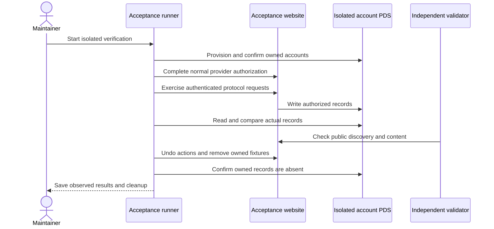

# Publishing verification

Verify a release by following an approved post from saved source through its
public deployment, outside records, responses, and subscriber delivery. Keep
those observations distinct and retain the exact cleanup result. A build or HTTP
acceptance response cannot establish the whole path.

A personal data server (PDS) stores AT Protocol account records. Bluesky's AppView
indexes public responses; account DIDs identify their owners, while CIDs identify
record versions. Those identities let a runner compare and remove the records it
owns without assuming that every account record belongs to the test.

## Select the runtime and source state

Production runs on `willie-page`; `cloudflare.config.ts` selects
`willie-page-preview` in preview mode. The preview is private behind Access at
`preview.willie.page`, with isolated public publishing Hyperdrive and media
bindings. Studio draft storage is a separate private boundary. Do not substitute
the production publisher or database for a missing acceptance environment.

Use [IndieWeb HTTP checks](indieweb-testing.md) for current local coverage and
its harness limits. Build the selected Worker mode using the actual package
scripts, then follow the [deployment guide](../operations/deploy.md) to check its
exact revision, bindings, and public or signed owner access. A private Access
preview is not automatically readable by an independent public validator.

For an authenticated lifecycle, establish which private revision or public-file
compatibility path the test exercises. Verify owner consent through Access,
source persistence, public publication only when approved, outside PDS records,
response rendering, and final cleanup. R2 media needs its own byte, delivery,
and exact-object cleanup checks. Existing authored drafts remain private until
Willie approves their exact text and dates.

## Build a runner before a hosted run

No hosted acceptance runner is current. The October 2026 suite targeted a
Vercel project that no longer exists and was removed from the tree. A new hosted
run needs a reviewed runner for the Cloudflare preview: its target, credentials,
deployment, callbacks, media storage, owner authentication, and cleanup. Keep
the ownership guards the earlier runner established: record every resource a
run creates, and remove only those resources.

## Follow the verification and cleanup boundary

A run keeps these observations distinct on its actual runtime:

The runner sends real requests to the acceptance site and reads the isolated PDS. The independent validator checks the public site separately. Both results are required where the corresponding issue requires them. Remove temporary content and verify production remains free of fixtures before closing the release work.

A timed-out mutation may complete after its HTTP response is lost. Cleanup must compare current records with the exact owned CID inventory and retain its journal until stable graph, grant, source and publication cleanup passes. Do not accept an old cleanup receipt as ownership of a new fixture.

## Release to production

### Validate the current release revision

Run lint, TypeScript, the full unit suite, and the selected Cloudflare package
build on the release revision. Build the production and preview modes separately.
The deployment guide describes the current `cf` path and revision gate. Acceptance verification remains separate from these local checks.

Deploy the checked production revision after final capture review passes. Verify the production publication HTTP/PDS agreement, public OAuth/discovery endpoints, feed responses and absence of acceptance content. Existing authored drafts remain private. Production document/recommendation verification requires Willie to approve a real writing for publication; isolated acceptance proves the behavior without publishing a draft.

### Do not replay finished migrations

The one-time production migration used a guarded helper that locked the
authorization tables, applied only 006–009 in one transaction, and compared
all seven original token fields before commit. That helper was removed after
completion; do not reapply these migrations. Retain its private baseline and
receipt. Follow any ambiguous future migration with a fresh read-only check
instead of assuming rollback.

A new release needs fresh observations from the current Worker, including its
Access owner path, Hyperdrive state, R2 media, notification revision, and outside
interoperability. The October results remain useful regressions to repeat; they
are not authority to publish a draft or substitute old provider evidence for the
migrated runtime.

## Record verifier identity and cleanup

New receipts can include `verifierSourceFiles`; callback-delivery proofs also
include `probeSourceFiles`. These maps hash the entrypoint and its local source
dependencies without executing them. Retain the existing entrypoint hash.
Older receipts without a module manifest remain readable with their original
scope. Cleanup preserves the verification manifest, including its absence on an
older receipt, and records its own implementation in `cleanupSourceFiles`.
A cleanup run cannot expand what the earlier verifier established.

## Historical record

The [October 8–9 verification record](https://github.com/WillieCubed/website/blob/566f37b570df167f917f20217ee6fcd5131d12a8/docs/guides/publishing/publishing-verification.md) describes the Vercel
acceptance runs, their receipts, and their cleanup. It explains what those runs
observed; it does not establish current Cloudflare interoperability.
