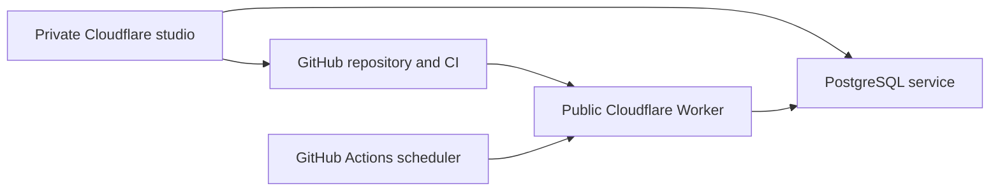

# Maintain Music

This document is for the website maintainer. Use it to deploy and diagnose the
owner's Music editor without publishing private selections.

The owner starts at `/admin`, opens Music, connects Spotify, and selects
playlists. Setup saves privately. Review and Publish bind the public catalog to
one immutable saved revision. Spotify imports never change playlists or publish
new selections.

## Storage and approval

Private Music tables share the studio database. Immutable revisions preserve
both sides of concurrent edits. A separate database role can read only the
approved provider cache. The public page intersects that cache with the
committed `content/music/catalog.json` selection and excludes records older
than 24 hours.

The deployment diagram shows the applications involved in publication and
refresh.

The publisher creates one recoverable PR per revision and respects repository
checks and rebase merge protection. Unrelated main changes produce a new
proposal commit. A changed public catalog stops publication for review. The
editor reports Live only when the public proof matches the revision, source
blob hash, and deployed commit or its verified descendant.

## Provider configuration

Spotify app `e454b680b63243c9940fe1173214d8da` uses the exact callback
`https://preview.willie.page/api/studio/music/spotify/callback`. The owner
connects through PKCE with playlist read access. The service encrypts tokens
and retains refresh replacements. Spotify revocation requires reconnecting;
curation remains saved.

`SPOTIFY_CLIENT_ID`, `MUSIC_TOKEN_ENCRYPTION_KEY`, and the private database
connection stay server-side. The key must remain stable. The public Worker
uses `MUSIC_PUBLIC_DATABASE_URL` with a read-only role for gallery requests.
Its bearer-authenticated refresh route uses `MUSIC_PRIVATE_DATABASE_URL` and
`MUSIC_CACHE_WRITE_DATABASE_URL` with a role limited to Music provider data.
The Worker opens a database connection per request because a PostgreSQL socket
cannot be reused across Worker requests.

## Provision and verify

Prepare a private mode-0600 environment file containing
`STUDIO_DATABASE_URL` and the existing `STUDIO_TOKEN_ENCRYPTION_KEY`. Run
`pnpm exec tsx scripts/music/provision.mts PRIVATE_ENV PRIVATE_STATE_JSON`.
Keep the state file private during retries. The script applies idempotent
migrations, verifies database isolation, configures the production Cloudflare
Worker through the named `williecubed` `cf` profile, and stores the scheduler
secret without printing it. The private Studio uses its existing Cloudflare
Hyperdrive and encryption-key bindings; this script does not deploy that Worker
or copy `SITE_MODE` to production.

The hourly GitHub workflow remains disabled until repository variable
`MUSIC_REFRESH_ENABLED` is `true`. Verify an authenticated POST to
`https://willie.page/api/music/refresh` before enabling it. Invalid credentials
must return 401. Refresh reads only committed approved IDs. A confirmed private
or removed playlist is suppressed immediately; transient failures retain the
last good result for at most 24 hours.

Run `STUDIO_TEST_DATABASE_URL=... pnpm test` for database integration checks.
Run `MUSIC_E2E=1 node scripts/studio-e2e.mjs` for authenticated admin browser
checks and full desktop/phone captures in both themes. The local harness uses
signed JWTs and an isolated PostgreSQL schema; it has no auth bypass.

## Hosted acceptance remains required

A passing build does not prove Spotify consent, owner eligibility, GitHub token
permissions, or publication. Complete the hosted checklist in the
[launch plan](superpowers/plans/2026-10-12-music-production-launch.md).
Never publish fixture data or choose editorial selections for the owner.
