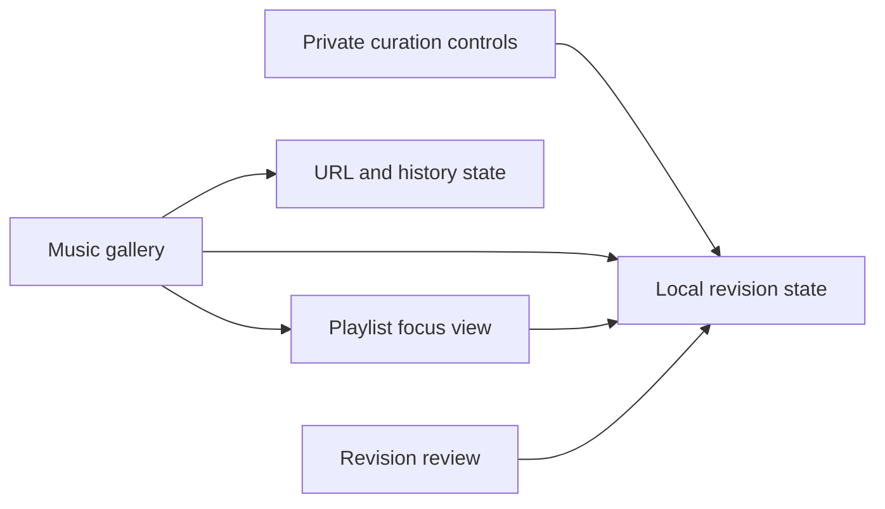

# Website issue plan

This plan is for the engineer implementing Willie's website changes. Build and
review the Music prototype first, then complete its private curation and provider
integration. Publish About only after Willie approves its exact content and
release. Research is deferred.

## Decisions recorded on October 11, 2026

| Issue                                                   | Decision                                    | Completion requirement                                                    |
| ------------------------------------------------------- | ------------------------------------------- | ------------------------------------------------------------------------- |
| [#44](https://github.com/WillieCubed/website/issues/44) | Display selected owned Spotify playlists.   | Verify real provider data, private curation, and public browsing.         |
| [#45](https://github.com/WillieCubed/website/issues/45) | Build the gallery at `/music`.              | Verify series, focused context, shareable state, and responsive behavior. |
| [#40](https://github.com/WillieCubed/website/issues/40) | Prepare About around Willie's current work. | Obtain exact-content and release approval, then verify production.        |
| [#41](https://github.com/WillieCubed/website/issues/41) | Research is closed as not planned.          | Keep Research unpublished until Willie explicitly resumes it.             |

Willie makes playlists as albums and compilations, including playlists he may
rarely revisit. He also makes ordered series such as Fall Tour and seasonal
playlists. Listening activity and recency must not determine prominence.

Willie chose website-based curation. He rejected separate playlist pages because
the gallery can show their information in context, using the homepage's focused
media interaction. The public site therefore uses one `/music` route.

## Music experience

- Let headings stand on their own. Do not add decorative overlines or eyebrow
  text. Put track counts and series positions below playlist titles.
- Use selectable tonal buttons for series and keep counts quiet. Distinguish the optional
  featured playlist through cover size, title size, authored notes, and space.
  Do not add a decorative badge or eyebrow. Expose its status to screen readers.
- Let the Music page, its top bar, and its prototype controls share a 1600px
  maximum width. This page needs room for artwork and collection browsing.
  Keep other pages at their existing widths.
- Keep the phone focus view's cover and title beside one another. Put editing
  controls and the track sequence across the full width below them. Preserve
  the larger cover and adjacent context on desktop.
- Show an optional lead playlist once, followed by the selected collection in
  Willie's order. Featuring is an explicit editorial choice, independent of
  listening activity or recency. All selected playlists remain public; unselected
  playlists stay private. Keep complete artwork square and intact.
- Give series visible navigation. Selecting a series changes the gallery in
  place, shows its notes, and uses the series' explicit playlist order.
- Use native buttons for interface actions. Give curation and playlist opening
  visible button affordances. Reserve underlines and link styling for web
  navigation. Expose the selected series through its pressed state.
- Open a playlist into a focused view with its cover, title, notes, ordered
  tracks, series context, and a Spotify link. Use a two-column modal on desktop
  and a full-screen view on phones.
- Encode the selected series and focused playlist in the URL. Support direct
  entry, refresh, Back, Forward, Escape, restored focus, and retained scroll.
- Let visitors move between playlists in the current collection. Keep repeated
  songs and unavailable positions in the track list.
- Show one search field within the selected collection. Omit the top bar's
  search trigger on Music. Keep actions available on touch and
  keyboard input, with reduced-motion fallbacks.
- Expand the focus surface from the clicked cover's bounds while the cover
  moves independently into place. Reverse the transition on dismissal when
  the destination cover remains visible. Fade the controls and title in
  before the track list. Separate spatial movement from opacity changes,
  following [Material motion](https://m3.material.io/styles/motion).
- Show part of the next collection row on initial load. If the viewport cannot
  reveal at least 56px of its first cover, show a More playlists button that
  scrolls there and moves keyboard focus to that playlist. Recheck after fonts
  load and the viewport changes. Hide the cue after the visitor scrolls.

The gallery uses these layouts. Series and search results use equal cards in
their own order without promoting the featured playlist.

| Width            | Featured playlist                                                        | Remaining collection |
| ---------------- | ------------------------------------------------------------------------ | -------------------- |
| Below 600px      | Larger square cover with title and notes below it                        | Two columns          |
| 600–839px        | Larger cover beside the title and notes                                  | Three columns below  |
| 840–1199px       | Larger cover beside the title and notes; series rail at left             | Three columns below  |
| 1200px and above | Cover spans two collection columns; title and notes occupy the other two | Four columns below   |

The previous horizontal phone composition made the featured cover nearly the
same size as a regular cover. Moving its caption below the artwork restores a
visible distinction without using a full-screen cover. The featured cover stays
larger through each breakpoint. No feature selection means an equal card grid;
the site must not silently promote the first playlist.

## Private curation and publication

Extend the authentication, revision storage, recovery, and publication review
from [PR #201](https://github.com/WillieCubed/website/pull/201). The live
`preview.willie.page` library and editor were inspected. The PR remains a draft;
its current publisher cannot publish through protected main.

- Add Your music to the private site. Attach selection, prominence, notes, and
  series actions to the gallery and selected playlist.
- Import playlists privately. Require explicit selection before publication.
- Save the whole editorial catalog as one immutable revision, including global
  order, the optional lead, notes, and ordered series memberships.
- Support drag reordering and keyboard alternatives. Reuse autosave, conflict
  preservation, history, and recovery from the studio foundation.
- Use the same gallery renderer for private review and public browsing.
- Introduce explicit studio content kinds for writings and the music catalog.
  Preserve existing writings and scope writing endpoints to that kind.
- Publish a reviewed catalog to `content/music/catalog.json` through a typed,
  allowlisted adapter. Complete the protected PR and CI publication path before
  connecting the editor's publication action.
- Bind approval to the selected immutable revision. Mark it live only after the
  deployed site serves that revision. Preserve conflict checks and retry safety.
- Keep this integration independent of unrelated widget-generation acceptance
  work. Reconcile studio migration numbering against integrated main.

Spotify remains the source for tracks and their sequence. The website does not
edit Spotify playlists. Editorial notes are Willie's words; agents must not
invent them.

## Provider and public interfaces

- Use server-side owner OAuth and paginated `GET /me/playlists` with read scopes.
  Only owned records with `public === true` are eligible for publication.
- Keep credentials and the import library private. Give public routes only the
  approved projection. Validate eligibility again before publication.
- Refresh metadata hourly and ordered items when `snapshot_id` changes. Check
  the snapshot around pagination and reject mixed versions.
- Preserve curation during refresh. Serve visitors from a server cache and load
  track data for the focused playlist without visitor authentication.
- Keep the last successful data for up to 24 hours during transient failures.
  Suppress a record immediately when a successful check finds it ineligible.
- Expose connection and refresh failures in the private editor. Handle revoked
  credentials, expired tokens, incomplete pages, and rate limits.
- Add `/music` to navigation, search, metadata, and the sitemap at release.
  Focused links have matching metadata with `/music` as their canonical route.
- Follow Spotify's artwork, attribution, and source-link requirements. Omit
  modification dates rather than presenting an inferred date as exact.

## About and Research

Repair the unrouted About proposal so it can be reviewed privately without
registering a public page. Preserve the portrait and approved source wording.
Remove the proposed research section from the intended About release. Review
historical claims with Willie and record exact-content and publication approval
before adding `/about` or any discovery entry.

Do not build or publish Research, change research draft flags, or add academic
material to About as a substitute. Preserve the existing private sources. A
future explicit request from Willie is required to resume #41.

## Prototype and delivery

The local prototype is ready for review on October 11, 2026. Start it with
`pnpm dev:app --hostname 127.0.0.1 --port 3137` and open
`http://127.0.0.1:3137/prototypes/music`. Use **Curate music** to edit selection,
notes, the lead playlist, and series membership or order. Review the complete
selection and context before applying it to the prototype gallery.

The first prototype is local and uses clearly marked fictional playlists,
artwork, and tracks. It demonstrates browsing, series order, focused context,
private editing, saved local drafts, and review before applying changes. Its
apply action changes only browser-local prototype state. It connects to no
provider and publishes nothing. The prototype route returns 404 in production.

The component diagram shows modules within the prototype application.

Deliver Music first, then About after approval. Keep #41 closed as not planned. Do not close
#44 or #45 based on the prototype alone.

Verify the prototype at 1440px and 390px in both themes, plus 320px reflow.
Exercise touch, keyboard, Back and Forward, direct links, unavailable tracks,
draft recovery, and review/application separation. Capture screenshots.

The prototype passed 50 browser checks across desktop and touch-emulated phone
layouts in both themes. The two phone projects skip native mouse dragging;
their earlier and later buttons pass. The checks include native surface and
cover transitions, staggered content, interrupted motion, missing transition
support, keyboard focus, and scroll affordances in short viewports. The layout
pass checked 11 widths from 320px to 2560px in both themes on October 11.
The featured cover remains at least
1.5 times as wide as regular covers, with no horizontal overflow.

This revision passed all 880 repository tests, lint, type checking, and the
production build. The build retains warnings in unchanged highlight CSS,
font fallback generation, and filesystem tracing. All 9 command palette checks
passed against the production build, including Space activation and search
navigation without JavaScript. Its production HTTP checks confirmed
that the prototype, About, and Research return 404 and stay out of the sitemap
and search index. These checks do not verify Spotify or hosted publication.

Run the browser checks against the development server with
`pnpm exec playwright test --config tests/music-prototype.config.mts`.

For the production feature, also verify real Spotify access, pagination and
snapshot races, eligibility changes, stale data, conflicting saves, protected
publication, CI failures, deployment receipts, and draft exclusion from every
public discovery path. Run the repository's required checks with bounded
concurrency. Local tests, hosted editor checks, real provider checks, and public
deployment checks are separate evidence.
