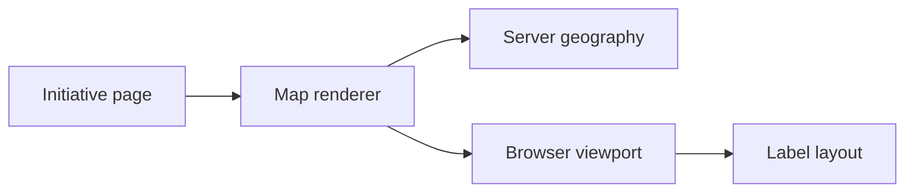

# Initiatives

An initiative gives a campaign, series, or project an overview and, when needed,
a sequence of parts. Fall Tour 2026 can have both a page describing the trip and
numbered pages telling its story. The Willie Diaries and Project Superbloom also
use this model.

Organizations and ventures with their own websites—Las Vegans for Better
Transit, Hypertext Studio, and the Reasonable Tech Company—belong in
`lib/home/ventures.ts` instead. Those records introduce the work and link out;
an initiative holds an account on this site.

Initiative pages live under `/initiatives` and read `content/initiatives/`.
After editing them, run `pnpm typecheck && pnpm build`; invalid schema values
fail the build.

## Files

```
content/initiatives/<slug>/index.mdx        the initiative page
content/initiatives/<slug>/parts/<n>.mdx    one act, served at /initiatives/<slug>/part-<n>
public/assets/initiatives/<slug>/           cover art and part media
```

The overview and its parts share a directory, but each part's frontmatter number
determines its public `part-<n>` address. Renaming a source file does not
renumber the story. Underscore-prefixed directories and part files are ignored,
and `opengraph-image` is reserved for the image route.

### Loading and validation

The loader is `lib/initiatives/index.ts`. It validates frontmatter with the zod
schemas in `lib/initiatives/schema.ts`, resolves each status from its dates when
the author leaves `status` out, and exposes `getInitiatives`, `getInitiative`,
`getPart`, `getFeaturedInitiatives`, and `currentPart`. The loaders resolve
statuses against the clock when reading the records. React `cache` shares an
initiative list within one server render; it does not retain a mutable snapshot
between requests. Inspect the consuming route's caching when diagnosing a stale
rendered status. The homepage loads one visible initiative snapshot and derives
both featured tiles and compact playbills from it. The pure `featuredInitiatives`
and `featuredTiles` helpers leave that snapshot unchanged. Tile parent names come
from the same snapshot.

## Initiative frontmatter

The overview fields describe the initiative wherever it appears. Keep the
`description` useful outside the page: the index, search metadata, and hover
card cannot rely on the visitor having read its introduction.

| Field         | Required | Meaning                                                                                                                    |
| ------------- | -------- | -------------------------------------------------------------------------------------------------------------------------- |
| `title`       | yes      | The name.                                                                                                                  |
| `tagline`     | yes      | One line under the title.                                                                                                  |
| `description` | yes      | One or two sentences for the index card, the meta description, and the hover card.                                         |
| `kind`        | yes      | `campaign`, `series`, or `project`. Search tags the initiative with it; the page never prints it.                          |
| `parent`      | no       | Slug of the initiative this belongs to. Fall Tour sets `twd`. An unknown slug fails the build.                             |
| `status`      | no       | `planned`, `active`, `paused`, `complete`, `archived`. Leave it out to derive it from `starts` and `ends`.                 |
| `starts`      | no       | ISO date. Falls back to the first part's start.                                                                            |
| `ends`        | no       | ISO date. Falls back to the last part's end.                                                                               |
| `updated`     | no       | ISO date of the last real edit. Sets the sitemap's last-modified date; leave it out when unsure.                           |
| `brand`       | no       | A `#rrggbb` seed or a key in `lib/brand/seeds.json`, resolved to its hex when loaded. An unknown key fails the build.      |
| `cover`       | no       | `{ src, alt, kind?, aspect? }`. Used for the hero, the index card, and social images. A missing file fails `pnpm test`.    |
| `trailer`     | no       | `{ title, youtubeId?, poster? }`. Without `youtubeId` the page shows the poster or cover in the video's frame.             |
| `partLabel`   | no       | The word before an act number. Defaults to `Part`; The Willie Diaries uses `Era`.                                          |
| `website`     | no       | The initiative's own site, as an `https://` URL. The hero links to it; Superbloom points at its own site.                  |
| `links`       | no       | `[{ label, href }]`. Chips at the end of the page. A chip whose in-site page is still a draft stays hidden until it ships. |
| `syndication` | no       | `[{ platform, url }]`. Copies of this page elsewhere. Parsed but not rendered yet.                                         |
| `feature`     | no       | Puts the initiative on the homepage. See below.                                                                            |
| `draft`       | no       | Hidden in production.                                                                                                      |

### Dates and resolved status

Use calendar days such as `2026-10-12`, without a time or offset. A tour starts
on a day; it does not need the publication instant that a writing records.
`DateSchema` keeps that day at local midnight so YAML's UTC interpretation
cannot make it display as the previous day west of Greenwich.

With no explicit `status`, the loader resolves `planned` before `starts`,
`active` once it has started, and `complete` after the end of the `ends` day. An
undated initiative resolves to `planned`. Set an explicit value for a state such
as `paused` or `archived` that dates cannot express. Missing overview dates come
from the first and last numbered parts, keeping the overview tied to the
sequence it introduces.

`updated` records a meaningful editorial change for the sitemap. Leaving it
unset is preferable to presenting an arbitrary date as evidence of freshness.

### Media and links

A cover is shared by the hero, index card, and social image. Its `aspect` is a
positive width-to-height ratio that reserves space before loading; `kind`
defaults to `image` and also accepts `video`. The media schema additionally
supports `decorative: true` with empty alt text under the site's image policy.
Describe the image itself in its alternative text, so the description still
works when the same cover appears away from the initiative page.

`trailer` may exist before its YouTube video does. Without `youtubeId`, the
poster or cover occupies the video frame; that supports a prepared layout
without implying a published video. `syndication` records copies elsewhere but
is not yet rendered, so setting it does not add public copy links.

## Part frontmatter

A part is a numbered act within its initiative. The Playbill, the page's ordered
list of acts, uses these fields to show the sequence and its current position.

| Field         | Required | Meaning                                                                  |
| ------------- | -------- | ------------------------------------------------------------------------ |
| `number`      | yes      | The act number. The URL is `part-<number>`. Two parts cannot share one.  |
| `title`       | yes      | The part title, combined with its initiative name outside the page.      |
| `tagline`     | no       | One line under the title in the hero and the Playbill.                   |
| `description` | no       | Meta description. Falls back to the tagline.                             |
| `starts`      | yes      | ISO date.                                                                |
| `ends`        | yes      | ISO date, no earlier than `starts`.                                      |
| `updated`     | no       | ISO date of the last real edit. Sets the sitemap's last-modified date.   |
| `status`      | no       | Same values as above; derived from dates when missing.                   |
| `places`      | no       | `[{ name, region?, lat, lng }]` in travel order. Drawn on the route map. |
| `cover`       | no       | Hero media. Falls back to the initiative cover.                          |
| `milestones`  | no       | `[{ id, label, date, done? }]`. Listed in the sidebar in date order.     |
| `draft`       | no       | Hidden in production, like a draft initiative.                           |

### Sequence, places, and milestones

`number` is a positive integer, unique within its initiative. Parts sort by that
number, while milestones sort by date. A part's position in the story and a
milestone's date are independent: rearrange the source entries without changing
either the numbered sequence or the chronological sidebar. An `ends` value
before `starts` fails loading rather than producing a contradictory date range.

Places stay in travel order. Each requires a name and latitude/longitude in the
valid ranges −90 to 90 and −180 to 180; `region` is optional. Reordering places
changes the route the map draws. Milestone `done` defaults to `false`, so a
listed event is not automatically presented as accomplished.

A part can be drafted independently of its parent. Its production visibility
therefore needs review alongside the initiative's own draft flag, particularly
when overview dates are inherited from the visible part sequence.

## The homepage `feature` block

A `feature` block adds an initiative to the homepage tile grid. The grid mixes
ventures and initiatives, so `weight` sets their relative order rather than
sorting each group separately. In this example, Project Superbloom's weight of
90 places it near LVBT at 100 and ahead of Atlas at 10:

```yaml
feature:
  weight: 90
  size: w3 h3
  hint: What's blooming
  focuses: [tools]
```

### Choosing prominence

Choose `weight` for order and `size` for the space the tile needs. Changing a
grid span does not change its position. Weight accepts integers from 0 to 100;
size accepts `w2 h2`, `w2 h3`, `w3 h2`, `w3 h3`, `w4 h3`, or `w6 h3`, with `w3
h3` the default.

The required `hint` appears on hover. It can invite someone into the initiative
rather than repeating its card description. `focuses` names interests in
`lib/home/focuses.ts` and defaults to an empty list. Those IDs connect the tile
to the homepage rail: choosing an interest there highlights work that serves it.

## Writing the body

The body carries the story; frontmatter supplies its title, dates, and
navigation. Write Markdown for ordinary prose and use MDX when the account
benefits from one of the page's media components.

### Scenes, galleries, and routes

Initiative and part pages support:

- `<Scene src="/assets/initiatives/x/1.jpg" alt="…" flip caption="…">prose</Scene>`
  puts media beside a few paragraphs. Alternate `flip` down the page.
- `<Gallery items={[{ src, alt }, …]} columns={3} />` is a photo grid.
- `<RouteMap places={[{ name, lat, lng }]} />` draws a server-rendered geographic map.
  Place coordinates and land outlines use the same scale. Mainland US trips
  retain national context rather than stretching neighboring towns across the
  map. Mixed mainland/Hawaii trips use a labeled inset inside the same map,
  with its own scale. Honolulu shares city selection and zoom controls with
  mainland stops.
  `routes={[{ label, places }]}` separates trips without implying travel between
  them. Curved legs preserve each stop and indicate travel order; they do not
  claim to trace flight paths, roads, or railways. City names remain beside their
  map points at a fixed readable text size.
  Nearby stops group under a city name and count when their labels would crowd.
  Selecting a group fits its cities; the selected names appear together beside
  the map. Leader lines connect displaced labels to their geographic points.
  Selecting a city zooms into its area. The “Zoom to city” picker also reaches
  labels outside the current view. Zoom buttons, drag panning, arrow-key panning,
  and Show all share the same viewport. Each trip retains its full ordered stop
  list in HTML, including repeated departures and returns. Map points, picker
  options, and place summaries deduplicate those visits. Repeated home stops
  remain separately selectable instead of joining nearby city clusters. Trip captions arrange cities vertically with colored stop markers
  and connecting lines. They use two columns on phones where the text fits and
  four on wide screens. Controls state their actions without explanatory copy
  beneath the map.
  Captions use the large spacing token (16px) inside the rounded frame.
  The complete caption shares one centered reading-width cap (768px); individual
  trip columns retain their responsive grid.
  The canvas follows its geographic frame's aspect ratio rather than imposing
  a minimum height. Height caps preserve the map's scale on wide screens.
  Hawaii overlays the lower-left Pacific inside the fixed 800×440 frame.
  It does not enlarge the canvas. Only the outer viewport clips the geography;
  mainland outlines continue behind the overlay without an internal cutoff. Keep label type and touch targets
  unchanged when tightening the map's surrounding space.
  Label placement considers neighboring labels together instead of moving
  each name around the labels placed before it. Leaders stop at the nearest
  label edge and stay within one 44px touch target plus the 4px gap. Label
  surfaces avoid unrelated city markers. Nearby cities can group when their
  labels cannot fit locally; inset cities never join mainland clusters.
  Home stops reserve their nearby label positions first. Placement scores both
  the text center and the leader length so a wide label cannot drift toward
  another city's marker merely to shorten its leader.
  Standalone part maps use the part's route color and pattern from the overview.
  City labels use 2px vertical and 4px horizontal surface padding. A transparent
  outer control preserves the full 44px touch height and at least 44px of width.
  Keep the text size unchanged when tightening the visible container.
  A rounded tonal viewport contains the cropped geography. Filled tonal controls
  use the site's shared MD3 action states. These boundaries also remain visible
  around the horizontally scrolling no-script map.
  Toolbar buttons use `Button size="extra-small"`: 32px visible surfaces inside
  48px touch targets. The native city picker uses the same container and target
  tokens. Its surface grows with enlarged text. The zoom buttons form a connected
  group with a 2px surface gap and 6px inner corners while retaining separate
  48px targets. The native picker sizes to its selected text instead of stretching
  across the toolbar. The toolbar uses extra-small outer spacing.
  Without JavaScript, the labeled map remains a horizontally scrollable SVG
  with its HTML labels; enhancement controls stay hidden. Dotted inset connections indicate travel order at a separate scale, rather
  than geographic flight paths.

The outlines come from Natural Earth's public-domain 1:110m Admin 0 countries
(version 5.1.1). `lib/initiatives/world-outlines.json` contains exterior rings
rounded to two decimal degrees from the
[Natural Earth source](https://github.com/nvkelso/natural-earth-vector/blob/master/geojson/ne_110m_admin_0_countries.geojson).
The downloaded source SHA-256 is
`6866c877d39cba9c357620878839b336d569f8c662d3cfab4cb1dbe2d39c977f`.
The server filters visible outlines before rendering. A small client viewport
receives projected city coordinates and server-rendered SVG content. Geographic
source data stays on the server; maps need no tile requests or mapping library.
The viewport draws markers in screen coordinates so zoom changes the geography
without magnifying dots. Server-rendered points remain the no-script fallback.
See the
[Natural Earth public-domain terms](https://www.naturalearthdata.com/about/terms-of-use/).

This component diagram records the server/browser ownership boundary. The map
renderer supplies projected SVG content; the viewport owns selection and gestures.



Fall Tour's overview combines the title, subtitle, dates, and large rounded-pixel
composition in one tall hero. Chapter covers retain comparable vertical space
for their illustration and title group. These sizes belong to the campaign;
they do not change the site's page gutters or top bar.

### What the page supplies

The part page renders the hero, milestones, places, and previous/next navigation
from frontmatter. Use the body to develop what happened and what it means rather
than repeating that schedule. A date or milestone can then change in one
structured source.

Previous and next parts share one row below the story. Their titles wrap
inside equal-width links, and the part number sits below the title. The
overview link occupies a separate centered row beneath both choices. First
and last parts render only their available neighbor without an empty slot.

Outside the initiative, a part needs a name that stands on its own. `partTitle()`
combines the initiative name, part label and number, and title: “Fall Tour 2026
Part 1: A Boy Goes Back to Dallas.” That full name supplies the context missing
from “Part 1” in a browser tab, search result, or link preview. See
[metadata.md](../design/metadata.md).

## Accessibility

The Playbill includes every act in order in the HTML, readable without
JavaScript. A future act stays visible with its date range; the current act
carries `aria-current="step"`. The sequence should remain understandable before
an act is available and without relying on animation to reveal it.

Scroll reveals are entrance effects. They must never hide content or make
scrolling a prerequisite for reading. When changing the interaction, check the
Playbill with JavaScript unavailable and reduced motion enabled.

## Campaign presentation

The full Playbill can render each part's cover beside its copy on wide screens
and above its copy on phones. Fall Tour uses one graphic in its centered
introduction and a text chapter list to avoid repeating near-identical covers. The compact
homepage Playbill keeps its text-only composition. Both use the same part
records and native destinations. Campaign-specific layout belongs in scoped
CSS, such as `components/initiatives/fall-tour.css`; it must not add a separate
client navigation or content model.

Fall Tour uses decorative SVG patterns of large rounded pixels that remain
distinct at phone widths. Titles and subtitles use pretty wrapping. Preview
pages omit draft eyebrows while retaining draft access rules. Keep the graphics abstract;
do not replace them with generated scenes or imitation photographs. Travel
dates, places, milestones, and public narrative belong in the content records.
Personal contact names, booking references, and private logistics belong in
Docket rather than public copy. Do not turn a future plan into a claim that
the event has already happened.

`tests/fall-tour.config.mts` checks all five draft pages through the authenticated
fixture. It captures uncropped desktop and phone views in both themes and
checks enlarged text, server-rendered covers, and native chapter navigation
without JavaScript.

## Open questions

Trailer video ids and documentary photographs are still to come from Willie.
The decorative SVG covers do not imply that footage or photographs exist.
Brand seeds for initiatives are hand-picked hexes because they have no site to
resolve from. When adding supplied media, rerun the media checks and review its
caption, crop, and loading behavior in the complete page.
