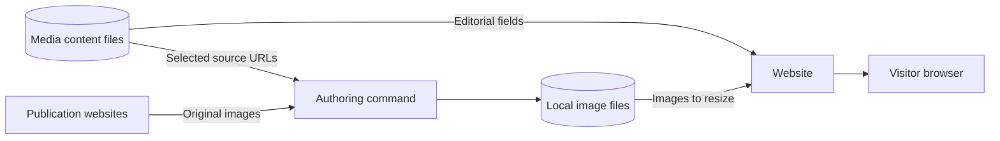

# Media mentions

`/media` collects published coverage in which Willie appears, whether in an
interview, a quotation, or a photo caption. Each mention has one Markdown file
in `content/media/`; its filename is the stable ID, using lowercase letters,
numbers, and hyphens. `lib/media/content.ts` loads the editorial fields from that file.

The archive records the publication's account rather than assigning Willie a
role in each story. Preserve the source headline, date, and attribution so a
visitor can understand what appeared and follow it to the publisher.

## Entry fields

Put the source record in frontmatter, the field block at the top of the file.
The Markdown body does not supply entry data. This photo-caption mention uses
the publisher's headline even though the headline does not name Willie; the
caption establishes the connection in the source article:

`content/media/las-vegas-sun-da-vinci.md`:

```yaml
---
title: Students Visit "Da Vinci-The Genius"
publication: Las Vegas Sun
url: https://lasvegassun.com/photos/2012/oct/01/451168/
published: '2012-10-01'
---
```

### Required source record

| Field         | Contract                                  |
| ------------- | ----------------------------------------- |
| `title`       | Publisher's headline; nonblank string.    |
| `publication` | Publication name; nonblank string.        |
| `url`         | Direct source URL using HTTP or HTTPS.    |
| `published`   | Quoted `YYYY-MM-DD` calendar-date string. |

Quote the date so YAML cannot normalize an invalid calendar day before the
loader checks it. The date comes from the publication, not the URL: FOX5 Vegas
published its Week Without Driving story on September 30, 2026 even though the
address includes October 1.

`lib/media/content.ts` rejects missing fields, invalid dates, unsafe source URLs, and
unknown keys with the filename in the error. Both search indexes and the page
read the same records, so repair the source file rather than patching an index.
A production build includes new entries; rebuild and deploy after a content
edit.

### Optional context and publication controls

`excerpt` is an exact short quotation. `related` is `{ label, href }`, with an
HTTP/HTTPS or site-relative address pointing to the work discussed. Omit either
when it adds no useful context. Excerpts start collapsed and remain usable
without JavaScript, keeping a long quotation from overwhelming an archive entry.

`draft` defaults to `false`. Set `draft: true` for a development preview that
stays out of production and search. Files beginning with `_` are ignored.
`featured` also defaults to `false`; the loader applies it only when the entry
has an image, since the larger presentation requires actual media.

### Selected image fields

| Field          | Contract                                                                                                            |
| -------------- | ------------------------------------------------------------------------------------------------------------------- |
| `image.src`    | Local JPG/JPEG, PNG, WebP, or AVIF under `/assets/media/`; lowercase letters, numbers, and hyphens in the basename. |
| `image.source` | Original asset's HTTP/HTTPS URL.                                                                                    |
| `image.alt`    | Nonblank description of what the image shows.                                                                       |
| `image.credit` | Nonblank attribution. Use the named photographer when available, otherwise the provider.                            |
| `image.fit`    | `cover` by default; `contain` for graphics that should not be cropped.                                              |

Selecting an image requires the first four fields together. The original URL
records where the asset came from; the local path identifies what the site
serves. Keep the description and attribution alongside both, so an image remains
intelligible and credited after it is copied. The link exposes that credit in
its title. Do not invent a photographer when the source gives only an
organization.

## Select and fetch an image

Image discovery and selection are separate decisions. The discovery command
finds candidates; the content file records which image belongs to the mention
and how to describe it.

### Inspect the candidates

After adding the article URL, run `pnpm media:discover <id>`, replacing `<id>`
with the filename without `.md`. Discovery also works when an entry already has
a selected image. It lists preview images, responsive and lazy-loaded photos,
video posters, and structured article metadata, including available alt text and
captions. Arc Publishing metadata supplies FOX5 video posters.

Read the captions and inspect the candidates before choosing. A preview image
can be a logo or an unrelated person; a later gallery image may be the one that
names Willie. For the Clark Scholars coverage, the research poster photograph
records Willie's work more directly than the gallery's first slide. The choice
follows what the mention is about, not the order in which the publisher presents
its images.

### Record the choice and fetch the original

For the Da Vinci photo-caption mention above, the selected photograph and its
credit are recorded as follows. Add the image fields to the content file, then
run `pnpm media:fetch <id>`:

```yaml
image:
  src: /assets/media/las-vegas-sun-da-vinci.jpg
  source: https://media.lasvegassun.com/media/img/photos/2012/10/01/1001DaVinci10_t650.JPG
  alt: Jeff Luo, Tenichi Mata, and Willie Chalmers III exploring the Da Vinci exhibit at the Venetian.
  credit: Steve Marcus / Las Vegas Sun
```

The command downloads into `public/assets/media/` without changing editorial
fields. `pnpm media:fetch --all` refreshes entries that already name a selected
source; it does not select images for entries that lack one.

### Replacement and build guarantees

The downloader decodes the response and checks its format before atomically
replacing the cached asset. A failed request, corrupt image, or write failure
leaves the existing file intact. That protects a previously usable archive image
from a bad refresh.

Downloads happen during authoring. Builds and visitors use local originals, so
an unavailable publisher does not break already fetched images. Next.js resizes
those originals for the layout. Shared responsive content images select
content-hashed copies for browser caching; authored source URLs, originals,
credits, and downloads stay unchanged. The
[performance guide](../../guides/operations/performance.md#images-video-and-byte-delivery)
owns eligibility, cache headers, replacement invalidation, and preview behavior. `pnpm content:check`, also run by the build,
checks every selected image for existence and decodability, including drafts,
without contacting the publisher. Run it after fetching and inspect the entry at
desktop and phone widths to assess crop and subject placement.



## Rendering

Most entries use compact thumbnails and retain their date order, keeping the
archive easy to browse across years. An explicit `featured: true` with a
selected image gives an entry the larger layout and moves it first within its
year. It does not move the entry into another year or change the publication
date. For the featured FOX5 coverage, the video still showing RTC Bike Share
bicycles gives the larger image a direct connection to the reported story.

An entry without an image reserves no thumbnail space. The archive can therefore
publish a verified source record before it has usable art; a missing image does
not require a placeholder or justify excluding the coverage.

The shared top bar and footer use the `media` column to align with the archive.
The top bar registers that column only while visible, preventing a cached page
from changing another route's footer. Before hydration, the shared footer
stylesheet reads the initial header only until the footer has its own
`data-column`. Check this alignment when navigating into and away from the
archive, not only when loading it directly.

The `/media` entry in `lib/site/navigation.ts` supplies metadata and adds the archive to
the footer, breadcrumbs, command palette, hover cards, search, and sitemap. Edit
coverage in `content/media/` and the archive page's shared identity in
`lib/site/navigation.ts`. A new mention belongs in the archive's records; it does not need
a separate navigation entry.

## Source verification and limits

### Unavailable sources

On October 5, 2026, RTC and Nevada Current returned HTTP 403 to direct article
and WordPress API requests. Those entries retained their source links and no
image. The result describes those requests on that date. The entries' text stays
published without replacement art; retrying later may find the source available.

### Finding coverage and establishing its date

The documented archive spans 2012 through 2026. Add older or newly discovered
coverage when its source is verified. Search within publications as well as
across the web: The UTD Mercury's search for `Chalmers` returned additional
campus stories that general search engines had missed.

Jonsson School stories do not display publication dates in their article bodies.
The [Fall 2021](https://engineering.utdallas.edu/news/archive/2021-fall/),
[Spring 2023](https://engineering.utdallas.edu/news/archive/2023-spring/), and
[Summer 2023](https://engineering.utdallas.edu/news/archive/2023-summer/)
archives supply those dates. The College Tour video uses YouTube's July 12, 2023
publication date. The separate October 18 news entry is Kent Best's Dallas
Morning News story republished on The College Tour's website.

A video release and a later article about it are separate records with their own
publication dates. The archive links above establish dates missing from article
bodies; an archive season alone would not establish a particular day. Retain the
source used for a disputed date so the next edit does not have to repeat the
investigation.
