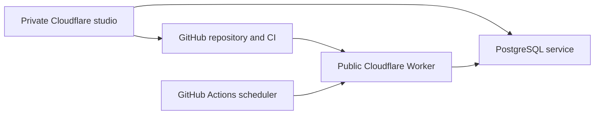

# Music

Music lets the owner curate playlists privately and publish a reviewed catalog.
Spotify imports supply provider data; they do not choose what the site presents.
This reference describes the saved selection, approval boundary, credentials,
and deployment checks that keep those responsibilities separate.

The owner starts at `/admin`, opens Music, connects Spotify, and selects
playlists. Setup saves privately. Review and Publish bind the public catalog to
one immutable saved revision, a snapshot retained unchanged. Spotify imports
never change playlists or publish new selections.

## Public showcase and discoveries

The public page introduces Willie's listening through playlists. Its voice can
use first person without treating the visitor as the collection's owner. When
the collection is empty or unavailable, an explicit recovery notice occupies
the normal content column beside the Music heading on desktop and below it on
mobile, with its contents centered. These are exceptions to the populated
gallery, rather than a Spotify landing page or onboarding flow. An unavailable
collection offers a native GET retry; Spotify remains an alternate destination.

Music's contextual command-palette entries recognize three unlisted aliases:

| Phrase           | Playlist                                                   |
| ---------------- | ---------------------------------------------------------- |
| main character   | The bildungsroman/train-window playlist                    |
| roll credits     | Songs that would make for great ending montages or credits |
| get to the point | Songs with unusually long entrances                        |

Aliases attach to stable playlist identities and are registered only for the
playlists available in the current experience. They find the normal playlist
destination; they do not start playback or open an animation automatically.

The ending-montage playlist offers an optional **Roll credits** disclosure beside
its normal track list. It presents the actual songs and artists in their
original order, followed by the music-supervision credit. Opening the disclosure
can start a finite, pausable roll. Taking over scrolling pauses it; leaving the
viewport or hiding the page suspends it. Reduced motion stops rolling, including
when the preference changes while it is running. Without scripts or motion
support, the native disclosure and manually scrollable credits remain readable.
No audio or additional provider request is started by either discovery.

### Track lists

Public and curation details share a segmented tonal track list, with 8px inner
corners and 16px outer corners. Titles and
artist names wrap fully; original track numbers and durations stay on one line.
Song titles align with the Track list heading and the surrounding detail copy.
Filled row containers extend beyond that text edge; sequence numbers sit beside
durations on the trailing edge. The list uses the site's Material surface, typography, spacing, and radius
tokens, with visible keyboard focus and forced-color boundaries.
Available songs and episodes link directly to Spotify in a new tab. Local files
and unavailable entries keep their sequence position and display explicit labels
without an inactive link or a playback control.

All tracks and provider links render in the initial HTML, in their original
order. The showcase prioritizes browsing Willie's playlists and following songs
to Spotify; it has no separate playlist or track search interface. Site-wide
Search keeps Cmd/Ctrl+K, and browser Find keeps Cmd/Ctrl+F. Reading the list
starts no provider requests and changes no curation data.

The detail toolbar reserves room for a compact visual title at widths of 840px
and above. It appears only after the entire main heading has scrolled out of
view and disappears as soon as that heading returns. Navigation controls keep
their positions; long toolbar titles truncate within the remaining space. The
main heading remains the single accessible title. On smaller screens, or
without scripts, the toolbar contains only its controls.
When the scrollport leaves its top position, the toolbar changes from the page
surface to Surface Container, following the [Material app bar's scroll treatment](https://m3.material.io/components/app-bars/).
Returning to the top restores the original surface. This applies at every
viewport width and introduces no divider, shadow, or layout shift.
Upgrading the server-rendered detail to a modal preserves its existing reading
position and focus context, so visitors can start reading before scripts finish
loading.

Opening and closing use a 380ms cover and surface transition when supported.
The opening title and tracks appear immediately, without a staggered entrance.
Track hover and press feedback changes only the surface color over 120ms.
Reduced motion disables these transitions and the compact title's entrance.
The dialog and scrollport use [nested transition groups](https://developer.chrome.com/docs/css-ui/view-transitions/nested-view-transition-groups)
to retain their clipping during motion. Browsers without that capability use
immediate navigation, preserving all content and controls.

Complete public playlists with at least 50 tracks have a quiet, static ending
after the final song. The default messages distinguish 50–149, 150–299, and
300-or-more tracks; known playlists have individual lines tied to their stable
identities. Short and partially loaded lists have no ending. The notes occupy
normal document flow, use a filled Material surface in both themes, and align
their text with the song titles using the same padding and container outset.
They introduce no animation, sound, or automatic scrolling.

The long Willie collection's ending links to Williecore when the shorter
playlist is available, eligible, complete, and shorter than the collection.
Otherwise it uses the ordinary long-list ending. The native in-site link works
without scripts. Enhanced navigation opens the shorter playlist at its heading,
resets the series scope to All playlists, and keeps Close and browser Back in
step with the URL. The curation editor retains its existing controls; endings
appear in its gallery preview and on the public page.

## Storage and approval

Private Music tables share the studio database. Immutable revisions preserve
both sides of concurrent edits. A separate database role can read only the
approved provider cache. The public page intersects that cache with the
committed `content/music/catalog.json` selection and excludes records older than
24 hours.

Eligible approved playlists render on the public page by default, including
without JavaScript. A missing or expired cache is unavailable, with a native
retry, rather than an empty collection. Empty means there are no approved
selections or every selection is known to be excluded. If some approved
playlists are still available, show them instead of replacing the gallery.

The private Studio holds working selections, while the public Worker serves only
approved data. GitHub carries the reviewed catalog between them:

### Publication proof and concurrent changes

The publisher creates one recoverable pull request (PR) per revision and
respects repository checks and rebase merge protection. Unrelated main changes
produce a new proposal commit. A changed public catalog stops publication for
review. The editor reports Live only when the public proof matches the revision,
source blob hash, and deployed commit or its verified descendant.

## Provider configuration

### Spotify authorization

Spotify app `e454b680b63243c9940fe1173214d8da` uses the exact callback
`https://preview.willie.page/api/studio/music/spotify/callback`. The owner
connects with playlist read access through PKCE, which binds the authorization
code to the client that requested it. The service encrypts tokens and retains
refresh replacements. Spotify revocation requires reconnecting; curation remains
saved.

### Encryption key and database roles

`SPOTIFY_CLIENT_ID`, the Music-only `MUSIC_TOKEN_ENCRYPTION_KEY`, and the
private database connection stay server-side. The Music key is separate from the
writing/Lattice key and must remain stable. It is backed up in the maintainer's
macOS Keychain as the `music-token-encryption` service for account
`willie-page`; do not copy it into the repository or command arguments. Both the
private preview and public Workers need this same Music key. The public Worker
uses `MUSIC_PUBLIC_DATABASE_URL` with a read-only role for gallery requests. Its
bearer-authenticated refresh route uses `MUSIC_PRIVATE_DATABASE_URL` and
`MUSIC_CACHE_WRITE_DATABASE_URL` with a role limited to Music provider data. The
owner preview writes approved rows through its existing private Music database
connection during publication. It does not need a second Music database
credential; the public Worker continues to use its restricted roles. The Worker
opens a database connection per request because a PostgreSQL socket cannot be
reused across Worker requests.

## Provision and verify

### Configure the Workers

Prepare a private mode-0600 environment file containing `STUDIO_DATABASE_URL`
and the existing Music key from Keychain as `MUSIC_TOKEN_ENCRYPTION_KEY`. Run
`pnpm exec tsx scripts/music/provision.mts PRIVATE_ENV PRIVATE_STATE_JSON`.
Replace `PRIVATE_ENV` with the private environment-file path and
`PRIVATE_STATE_JSON` with a private path for the provisioner's retained state.
Keep the state file private during retries. The script applies idempotent
migrations, verifies database isolation, configures both Cloudflare Workers
through the named `williecubed` `cf` profile, and stores the scheduler secret
without printing it. The private Studio uses its existing Cloudflare Hyperdrive
binding; this script sets only its Music encryption secret and does not copy
`SITE_MODE` to production. A Music key rotation must re-encrypt the saved
Spotify grant and update both Workers together; do not replace the secret alone.

### Refresh only approved selections

The hourly GitHub workflow remains disabled until repository variable
`MUSIC_REFRESH_ENABLED` is `true`. Verify an authenticated POST to
`https://willie.page/api/music/refresh` before enabling it. Invalid credentials
must return 401. Refresh reads only committed approved IDs. A confirmed private
or removed playlist is suppressed immediately; transient failures retain the
last good result for at most 24 hours.

### Local verification

Run `STUDIO_TEST_DATABASE_URL=... pnpm test` for database integration checks.
Run `MUSIC_E2E=1 node scripts/studio-e2e.mjs` for authenticated admin browser
checks and full desktop/phone captures in both themes. The local harness uses
signed JWTs and an isolated PostgreSQL schema; it has no auth bypass.

For public Music interactions, run
`MUSIC_E2E=1 STUDIO_TEST_SITE_MODE=public STUDIO_TEST_CONFIG=tests/music-public.config.mts pnpm exec tsx tests/support/studio/run.mts`.
This serves the actual public route against an isolated approved cache, keeps
Studio routes disabled, and checks the aliases, native credits, motion controls,
track readability and destinations, and empty-state alignment on mobile and
desktop in both themes.

## Hosted acceptance remains required

A passing build does not prove Spotify consent, owner eligibility, GitHub token
permissions, or publication. Complete the hosted checklist in the [launch
plan](../../superpowers/plans/2026-10-12-music-production-launch.md). Never
publish fixture data or choose editorial selections for the owner.
