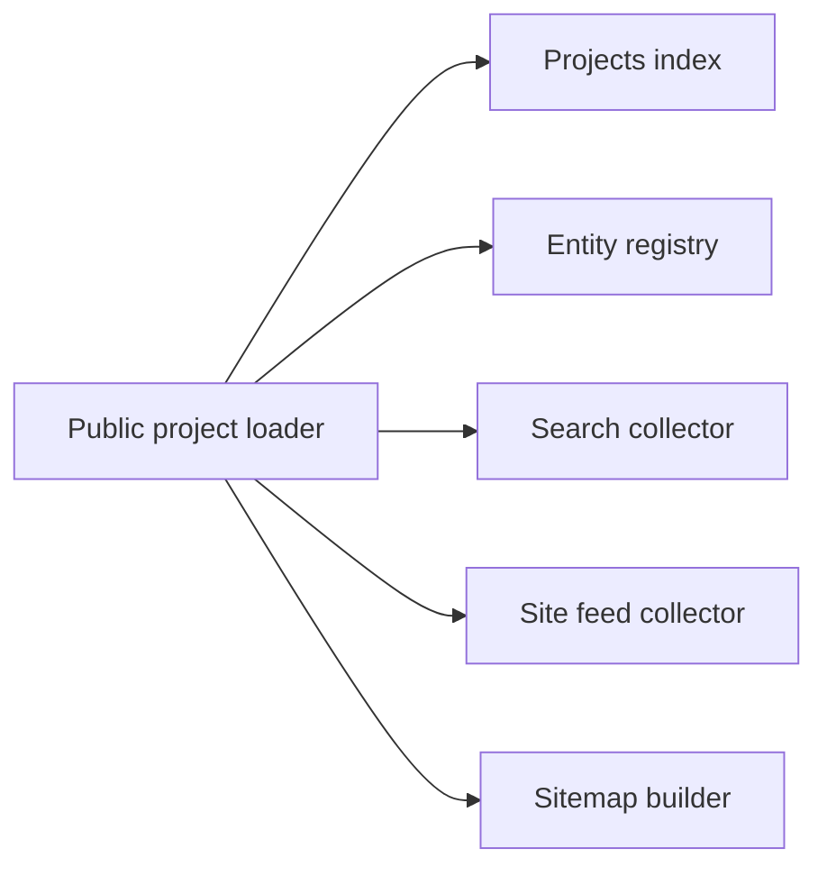

# Projects

Each project page reads `content/projects/<slug>.mdx`. The schema defines its
fields and visibility; Willie supplies the editorial content.

## Every sentence is Willie's own words

Every title, summary, body paragraph, caption, and image description must use
Willie's exact words. If you are an agent, copy his text without editing it,
including typos, or leave the field empty. Do not write, shorten, or reword
project copy. These pages represent his account of his work; a plausible summary
written by someone else would change that account.

This includes accessibility copy. When an image description is missing, obtain
Willie's words rather than supplying your own or bypassing the alt-text check.
The page omits empty optional fields, but a required field still needs valid
content before the record can pass validation.

The interface adds only the status names from `STATUS_LABELS` in
`lib/projects/facts.ts` and the host label for a link without a `label`.

## Where a project lives

Each project is one file, `content/projects/<slug>.mdx`. The slug is the
filename without its extension and supplies the URL: a file named `orbit.mdx`
serves `/projects/orbit`. Files that start with an underscore are skipped. Copy
`content/projects/_template.mdx` to begin.

The frontmatter, the fields at the top, holds the facts; the MDX body below it
holds Willie's account. Use `parent`, `initiative`, or `successor` for
relationships; placing one project inside another project's directory would not
establish those relationships or create a nested public URL.

## Frontmatter

The fields below describe a project's facts, relationships, and presentation.
`lib/projects/schema.ts` rejects unknown keys: a misspelled field fails the
build instead of silently disappearing from the page.

| Field           | Type                               | Meaning                                                                   |
| --------------- | ---------------------------------- | ------------------------------------------------------------------------- |
| `title`         | string, required                   | The project name.                                                         |
| `line`          | string                             | One line about the project. Also the page description.                    |
| `owners`        | list of owner keys                 | Organizations the project belongs to. Empty means Willie's own.           |
| `parent`        | slug                               | The project this one is part of.                                          |
| `initiative`    | slug                               | The initiative under `/initiatives` this project serves.                  |
| `successor`     | slug or `https://` URL             | Where the project went next.                                              |
| `roles`         | list of strings                    | What Willie did on it.                                                    |
| `collaborators` | list of `{ name, href? }`          | People he worked with. `href` is `https://`.                              |
| `starts`        | date                               | When it began.                                                            |
| `ends`          | date                               | When it ended.                                                            |
| `updated`       | date                               | When Willie last touched it.                                              |
| `status`        | see below                          | Left out, it is worked out from the dates.                                |
| `weight`        | integer, 0 to 100                  | Pins a project earlier in the sort. Default 0.                            |
| `visibility`    | `public`, `facts`, `hidden`        | See below. Default `public`.                                              |
| `brand`         | `#rrggbb` or a key in `seeds.json` | The color seed for the page.                                              |
| `website`       | `https://` URL                     | The project's own site. It leads the link chips and feeds the brand seed. |
| `media`         | list                               | Images, YouTube videos, and documents. See below.                         |
| `links`         | list of `{ href, label? }`         | Willie's links. A link without a `label` shows its host and path.         |
| `draft`         | boolean                            | Default false. See Drafts.                                                |

### Status from dates

`status` is one of `planned`, `active`, `paused`, `complete`, `unreleased`,
`handed-off`, or `archived`. With no explicit status, a future `starts` gives
`planned`, a past `ends` gives `complete`, a `starts` alone gives `active`, and
no dates give `planned`.

Dates use the shared calendar-day schema from initiatives. They describe the day
work began, ended, or changed rather than a publication timestamp. An explicit
status is appropriate when the calendar cannot say what happened—for example,
that work was handed off rather than completed.

### Media requirements

An image in `media` needs `kind: image`, `src`, and nonblank `alt`. A purely
decorative image sets `decorative: true` with `alt: ''`. The alt text is
Willie's. The full policy is in [accessibility.md](../design/accessibility.md),
and `pnpm content:check` enforces it. A video needs `kind: video`, `youtubeId`,
and `title`. A document needs `kind: document`, `href`, and `title`.

Images also accept an optional nonblank `caption`, in Willie's words. Use the
fields for the actual media type; the strict schema rejects a YouTube ID placed
in a document record rather than guessing which presentation you intended.

## Visibility

| Value    | Public result                            | Body and media available to consumers |
| -------- | ---------------------------------------- | ------------------------------------- |
| `public` | Header, body, and media                  | Yes                                   |
| `facts`  | Header only; suitable for an NDA project | No                                    |
| `hidden` | No page                                  | No                                    |

A facts-only project can acknowledge work covered by an NDA without publishing
its narrative or assets. The loader removes body and media from every
non-`public` project before passing the record to pages, feeds, or other
consumers. That keeps the restriction with the record instead of asking each
renderer to apply it independently.

Visibility and draft state answer separate questions. `visibility: public`
selects the full presentation once published; it does not authorize an agent to
clear `draft: true`.

## Drafts

A file with `draft: true` renders in development and returns 404 in production.
Only Willie clears a draft flag. An agent that migrates or adds a project leaves
`draft: true` in place.

Development preview and public discovery serve different stages of review. You
can inspect a draft detail page locally while the index, search, and other
discovery surfaces continue to select only published records. After Willie
authorizes publication, review those surfaces too: a correct detail page does
not show whether someone can find it.

## Brand

A project can have its own color identity or inherit its organization's. The
page uses a Material 3 Fidelity scheme—a palette derived from one seed color—
when a seed is available, and neutral colors otherwise. The first available
source in this order supplies it:

1. The project's explicit `brand` field.
2. The seed resolved from its `website`, stored by slug in `lib/brand/seeds.json`.
3. The `brand` of the project's first owner that has one.

An explicit field preserves a deliberate choice for this project. The website
source lets a project with its own site bring that identity with it, while the
owner supplies a fallback when the project has neither. You do not need to
assign a separate color merely to fill the field.

Run `pnpm brand:seeds` after adding a `website` or when the site's branding
changes. The script reads the live site and needs network access. Inspect the
resulting palette on the project page after updating it.

## Owners

An owner is a key in `OWNERS` in `lib/projects/owners.ts`. To add one, add a key
with `name`, an optional `href`, and an optional `brand` that names a key in
`lib/brand/seeds.json`. Use the organization's name exactly as Willie's own
records spell it. When neither the project nor its website supplies a seed, an
owner without `brand` leaves the project neutral.

Owners are shared records, so correcting an organization's name there affects
every project that cites its key. Add an owner for an actual organization rather
than using ownership as a substitute for a role or collaborator; those have
separate frontmatter fields and communicate different facts.

## Checking your work

Run `pnpm test && pnpm typecheck`. The tests load every file in
`content/projects` through the schema. Run `pnpm content:check` as well when you
touch an image.

Check the intended visibility as well as the schema. A facts-only preview should
have no body or media, and a hidden project should have no public detail page.
Confirm that supplied copy survived verbatim, including captions and image
alternatives. Keep the draft flag in place throughout this review; Willie
decides when the record can be published.

## The public index

### Current work and project records

The `/projects` index shows the published ventures and products from
`lib/home/ventures.ts` under Current work. Each card reuses the entry's title,
copy, and image alt text and opens its existing homepage detail view. A hidden
venture and its products do not appear. The cards stay neutral until a visitor
points at or focuses one, when its existing Fidelity scheme applies.

Published project files appear in a second section, which the index omits while
empty. Current work reuses the homepage copy; the project section adds Willie's
authored records as he publishes them. This keeps an unfinished project catalog
from suggesting that the public homepage work is missing. The top bar's global
search finds the published work. The layout uses one column below 600px and two
columns above it inside the same 840px content column as the top bar and footer.

### One publication boundary for discovery

`getPublishedProjects()` always calls the loader with `includeDrafts: false`.
The index, hover-card registry, sitemap, and site feeds use it even in
development. The search collector uses the same uncached loader option so it can
run under Node. Feeds leave out undated projects rather than invent a
publication date, and facts-only projects never carry body text or media.

Willie controls publication by clearing each file's draft flag. Project files
were still drafts when the index behavior was first documented; inspect the
current flags to establish which records qualify now.
