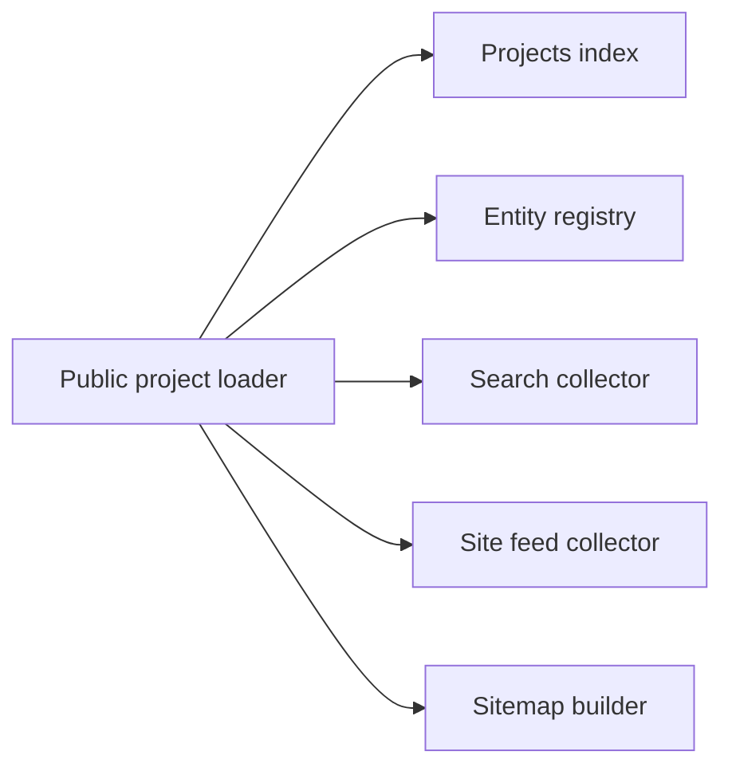

# Projects

Each project page reads `content/projects/<slug>.mdx`. The schema defines its
fields and visibility; Willie supplies the editorial content.

## Every sentence is Willie's own words

Every title, summary, body paragraph, caption, and image description must use
Willie's exact words. If you are an agent, copy his text without editing it,
including typos, or leave the field empty. Do not write, shorten, or reword
project copy. The page omits empty fields.

The page adds only the status names (`STATUS_LABELS` in `lib/projects/facts.ts`)
and the host label on a link that has no `label`.

This applies to accessibility copy as well as visible prose. An agent cannot
fill a missing image description with a plausible description and call the
record complete. Preserve supplied wording exactly or leave the field empty;
if a required field or alt-text check then fails, obtain Willie's text rather
than bypassing the schema. The rule protects how his work is represented, not
only whether a page looks finished.

## Where a project lives

Each project is one file, `content/projects/<slug>.mdx`, and the slug is the
URL: `content/projects/orbit.mdx` serves `/projects/orbit`. Files that start
with an underscore are skipped. Copy `content/projects/_template.mdx` to begin.

The body below the frontmatter is MDX, and Willie writes it.

The single file keeps a project's facts and authored account together. Use
`parent`, `initiative`, or `successor` for relationships; placing one project
inside another project's directory would not establish those relationships or
create a nested public URL.

## Frontmatter

The schema is `lib/projects/schema.ts`. It rejects unknown keys, so a misspelled
field fails the build and does not vanish.

| Field           | Type                               | Meaning                                                                   |
| --------------- | ---------------------------------- | ------------------------------------------------------------------------- |
| `title`         | string, required                   | The project name.                                                         |
| `line`          | string                             | One line about the project. Also the page description.                    |
| `owners`        | list of owner keys                 | Organizations the project belongs to. Empty means Willie's own.           |
| `parent`        | slug                               | The project this one is part of.                                          |
| `initiative`    | slug                               | The initiative under `/initiatives` this project serves.                  |
| `successor`     | slug or `https://` URL             | Where the project went next.                                              |
| `roles`         | list of strings                    | What Willie did on it.                                                    |
| `collaborators` | list of `{ name, href? }`          | People he worked with. `href` is `https://`.                              |
| `starts`        | date                               | When it began.                                                            |
| `ends`          | date                               | When it ended.                                                            |
| `updated`       | date                               | When Willie last touched it.                                              |
| `status`        | see below                          | Left out, it is worked out from the dates.                                |
| `weight`        | integer, 0 to 100                  | Pins a project earlier in the sort. Default 0.                            |
| `visibility`    | `public`, `facts`, `hidden`        | See below. Default `public`.                                              |
| `brand`         | `#rrggbb` or a key in `seeds.json` | The color seed for the page.                                              |
| `website`       | `https://` URL                     | The project's own site. It leads the link chips and feeds the brand seed. |
| `media`         | list                               | Images, YouTube videos, and documents. See below.                         |
| `links`         | list of `{ href, label? }`         | Willie's links. A link without a `label` shows its host and path.         |
| `draft`         | boolean                            | Default false. See Drafts.                                                |

### Status from dates

`status` is one of `planned`, `active`, `paused`, `complete`, `unreleased`,
`handed-off`, or `archived`. With no explicit status, a future `starts` gives
`planned`, a past `ends` gives `complete`, a `starts` alone gives `active`, and
no dates give `planned`.

Dates use the shared calendar-day schema from initiatives. They describe the
day work began, ended, or changed rather than a publication timestamp. An
explicit status is appropriate when the calendar cannot say what happened—for
example, that work was handed off rather than completed.

### Media requirements

An image in `media` needs `kind: image`, `src`, and nonblank `alt`. A purely
decorative image sets `decorative: true` with `alt: ''`. The alt text is
Willie's. The full policy is in [accessibility.md](../design/accessibility.md),
and `pnpm content:check` enforces it. A video needs `kind: video`, `youtubeId`,
and `title`. A document needs `kind: document`, `href`, and `title`.

For images, an optional nonblank `caption` is also supported and remains subject
to the same authorship rule. Media type determines the required fields: a
YouTube ID belongs to a video record, while a document uses its own `href`.
The strict schema catches misplaced or misspelled fields before a reader sees
an incomplete result.

## Visibility

| Value    | Public result                            | Body and media available to consumers |
| -------- | ---------------------------------------- | ------------------------------------- |
| `public` | Header, body, and media                  | Yes                                   |
| `facts`  | Header only; suitable for an NDA project | No                                    |
| `hidden` | No page                                  | No                                    |

The loader empties the body and media of every non-`public` project. Withholding
those values at the loading boundary protects all consumers, including feeds,
instead of relying on each renderer to remember the same condition. A
facts-only project can acknowledge work without disclosing its account or assets.

Visibility and draft state answer separate questions. `visibility: public`
selects the full presentation once published; it does not authorize an agent to
clear `draft: true`.

## Drafts

A file with `draft: true` renders in development and returns 404 in production.
Only Willie clears a draft flag. An agent that migrates or adds a project leaves
`draft: true` in place.

A direct development preview is useful for reviewing unfinished records, but it
is not the public catalog. Discovery consumers explicitly request published
projects even in development. Review the detail page as a draft, then review
discovery after Willie authorizes publication; neither check substitutes for
the other.

## Brand

The page uses a Material 3 Fidelity color scheme when it has a seed; otherwise
it uses neutral colors. The first available source below supplies the seed.

1. The project's own `brand` field.
2. The seed `pnpm brand:seeds` resolved from the project's `website`, stored by slug in `lib/brand/seeds.json`.
3. The `brand` of the project's first owner that has one.

Run `pnpm brand:seeds` after you add a `website` or after a project's site
rebrands. The script reads the live site, so it needs network access.

An explicit seed takes precedence because it records a deliberate choice for
this project. The website-derived seed follows, then the owner's brand supplies
a fallback. This lets a project have its own identity without requiring every
project under an organization to define a color. Inspect the resulting scheme
when updating seeds: a successful network fetch is not a visual review.

## Owners

An owner is a key in `OWNERS` in `lib/projects/owners.ts`. To add one, add a key
with `name`, an optional `href`, and an optional `brand` that names a key in
`lib/brand/seeds.json`. Use the organization's name exactly as Willie's own
records spell it. An owner with no `brand` leaves its projects neutral.

Owners are shared records, so correcting an organization's name there affects
every project that cites its key. Add an owner for an actual organization rather
than using ownership as a substitute for a role or collaborator; those have
separate frontmatter fields and communicate different facts.

## Checking your work

Run `pnpm test && pnpm typecheck`. The tests load every file in
`content/projects` through the schema. Run `pnpm content:check` as well when you
touch an image.

Check the intended visibility as well as the schema. A facts-only preview should
have no body or media, and a hidden project should have no public detail page.
Confirm that supplied copy survived verbatim, including captions and image
alternatives. Passing a content check does not grant editorial approval or
permission to clear a draft flag.

## The public index

### Current work and project records

The `/projects` index shows the published ventures and products from
`lib/home/ventures.ts` under Current work. Each card reuses the entry's title,
copy, and image alt text and opens its existing homepage detail view. A hidden
venture and its products do not appear. The cards stay neutral until a visitor
points at or focuses one, when its existing Fidelity scheme applies.

Published project files appear in a second section. The index leaves that
section out until there is a published project. The top bar's global search
finds the published work. The layout uses one column below 600px and two columns
above it inside the same 840px content column as the top bar and footer.

### One publication boundary for discovery

`getPublishedProjects()` always calls the loader with `includeDrafts: false`.
The index, hover-card registry, sitemap, and site feeds use it even in
development. The search collector uses the same uncached loader option so it can
run under Node. Feeds leave out undated projects rather than invent a
publication date, and facts-only projects never carry body text or media.

Willie still controls publication by clearing each file's draft flag. The content files were still drafts when this index behavior was documented;
that observation is not a permanent inventory. Inspect current draft flags to
establish which project records now qualify.

The two index sections serve different sources. Current work reuses the public
homepage records so those descriptions do not acquire competing versions. The
project section can grow when Willie publishes authored records; its absence
while empty avoids suggesting missing work to visitors.
