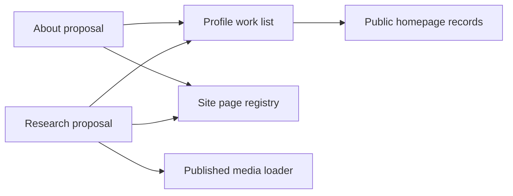

# Profile proposals

The About and Research proposals are not approved for publication. Keep both in
`app/_proposals` and leave them out of `sitePages` until Willie approves their
content and public release.

On October 11, 2026, Willie deferred Research while academia is on the
backburner. Do not resume its implementation or publication without a new
request. The intended About release focuses on his current work and omits a
research section. The [website issue
plan](../../plans/2026-10-11-website-issues.md) records the active Music and
About work.

The October 10, 2026 release published both pages without explicit content
approval. The correction removes their routes and discovery entries while
retaining the source for review. Implementation approval does not grant
permission to publish personal profile content.

## Design and implementation

### Retained October 10 design

The October 10, 2026 design uses the site's 840px content column, its warm
neutral surfaces, and the existing top bar. Each page starts with its name and
an introduction. About pairs its introduction with the existing portrait.
Research groups three questions before current work and dated research coverage.
The alternative was restoring the old resume and research pages. Their long
lists and dated model commentary do not describe the current public work.

### Proposal source and dated checks

The proposals use the existing metadata, links, and shared titles. They read
public venture records without rewriting their descriptions. Their source lives
in `app/_proposals/about` and `app/_proposals/research`. Neither folder creates
a public route. During the October 10 implementation, the integrated production
build, lint, types, and 879 unit checks passed. Visual review covered 320, 390,
600, 768, 1024, and 1440px in both themes. Accessibility checks at 390 and
1440px found no violations. The footer uses compact public-work and profile
columns, including on the homepage dock.

Those checks describe the retained implementation. They do not approve its copy
or override the October 11 decision to defer Research. Keep the source available
for review without restoring its routes or discovery entries.

## Sources and privacy

### Current public work

`lib/site.ts` provides the identity sentence and public organizations.
`lib/home/focuses.ts` provides About's focus lines. About includes only focuses
served by a visible public venture. `lib/home/ventures.ts` provides every work
card's exact name and description. Both pages link to existing homepage detail
views, and the list component excludes hidden ventures.

### Historical claims and research coverage

`app/_(pages)/about/page.tsx` records the August 2023 computer science degree,
2019–2023 Student Senate service, and the dated AI research experience. These
are historical claims. The new page does not restore the resume's employment
list or its availability claim. `public/assets/headshot.jpg` is the existing
1157px square portrait. Its new description follows a visual inspection of the
image.

`app/_(pages)/research/page.tsx` provides the research interests and the three
question headings. The new question descriptions explain those themes without
claims about publications or results. The current Lovelace reference comes from
the public homepage records.

`content/media/ut-dallas-clark-scholars.md` provides the title, publication,
date, and external link for the August 15, 2019 coverage. Research reads it
through `getMediaMentions({ includeDrafts: false })`. The source URL returned
502 during implementation, so the media record remains the source for that link.

### Material excluded from the proposals

Neither proposal loads projects, writings, or initiatives. Neither changes a
draft flag. No `/research/[projectId]` page moves out of the parked folder.
Draft detail pages stay private. A future research bibliography needs public,
verified records before adding entries.

## Component diagram

The proposal modules read the public sources and shared registry. The work-list
module renders the public venture descriptions.

