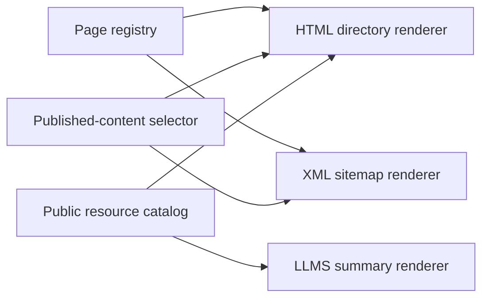

# Sitemap

The sitemap uses the page registry in `lib/site.ts` and the public resource
catalog in `lib/indieweb/resources.ts`. Add routed pages to the registry and
programmatic resources to the catalog. Do not maintain a separate URL list.

The footer includes Sitemap with its page links. Below 600px, those links stack
vertically. At tablet widths, they form a horizontal row below the name and
tagline. The social icons and Feeds button keep their original row. Footer
placement does not affect search: every routed page remains in site search and
the command palette, including Brand.

## Content selection

### Human directory and XML selection

The HTML directory at `/sitemap` puts top-level destinations under Browse. It
groups published initiatives and their parts, writings in publication order, and
topics in separate sections. Search appears as a human utility. The directory
omits its own link, empty content groups, and drafts, even in development. The
XML sitemap also excludes Search and retains only canonical URLs and actual
content modification dates.

### Resources a visitor can use

Both renderers use `publishedSitemapContent` for content selection. A new
published writing or initiative appears through the normal content loaders. The
reader-facing feeds and downloads come from the same catalog as `llms.txt`. A
resource's `directory` field groups its format variants under one description.
The HTML page does not list the internal hover-card index, crawler rules, or
protocol discovery files. The Tools section lists features a visitor can use:
browser search, MCP, Webmentions, and embeds. Each has a short description. A
tool requiring a client or request parameters shows its address, a usage note,
and a documentation link instead of a broken browser link. Publishing and
sign-in infrastructure stays out of the directory. AT Protocol discovery remains
conditional in `llms.txt`.

The directory's test is whether the entry gives a visitor somewhere useful to
go. Search qualifies as a human utility but does not represent indexable content
for the XML sitemap. An MCP endpoint may be useful while requiring a client;
showing its address and instructions is more honest than treating it as an
ordinary page. Authentication and publishing endpoints serve maintainers and
clients, so listing them as destinations would obscure that distinction.

## Layout and links

### Reading a destination

Each page and content link shows its name, route, and a short description.
Navigation rows use the site's neutral text and rounded hover and focus states.
Prose-style underlines appear only on active secondary links. Rows size to their
contents so wrapped descriptions stay inside the hit area. The text aligns with
section headings; padded interaction surfaces extend 12px beyond that text, as
on the writings index. Routes align right even when they wrap onto a second
line. Each feed collection shows one description and its available formats.
Tools describe their purpose instead of listing supported standards.

### Responsive rows and navigation

Sections have responsive grids: one column below 600px and two from 600px, with the same
column alignment in every section. Feed and file links use full browser
navigation because the app router cannot render their responses.

The route supplements the name rather than replacing it: visitors can recognize
both the destination and its address. Sharing one description across a feed's
formats prevents RSS, Atom, and JSON from looking like three unrelated content
collections. Full navigation for file responses is part of that same contract;
a download or feed document should be handled by the browser rather than a page
transition that expects an application view.

## Shared sources

Separate HTML and machine URLs let clients request a known format. User-Agent
detection and content negotiation would complicate caching and change existing
endpoints without improving the directory.

The sources remain shared even though the outputs differ. The page registry
owns routed destinations, the published-content selector owns editorial
eligibility, and the resource catalog owns feeds and downloads. Add a new
resource to its owning source rather than repairing the HTML directory alone;
otherwise `llms.txt` or the XML output can silently drift from what visitors see.

## Verification

After a registry or catalog change, run the repository checks and inspect the
rendered directory at desktop and phone widths. Confirm the following outcomes:

- A destination has a readable name, route, and description, with its full
  wrapped row inside the hover and focus area.
- Empty groups and draft content are absent, including during development.
- A feed or download opens as its actual response; a client-only tool offers
  usage instructions and a documentation link.
- The XML sitemap includes canonical content URLs and actual modification
  dates, while Search remains only in the human directory.

Check the owning source when an entry is missing before adding a duplicate URL
list. Protocol discovery files belong in their responses and maintainer docs;
their absence from this visitor directory is intentional.
