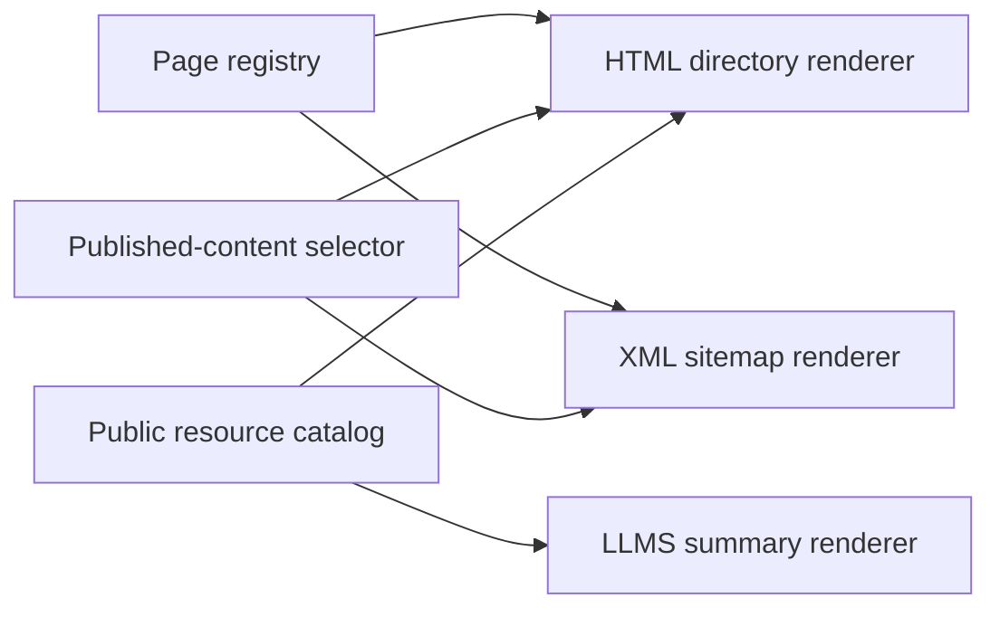

# Sitemap

`/sitemap` is a directory for visitors; the XML sitemap lists canonical pages
for crawlers. Both use the page registry in `lib/site.ts` and share published
content selection. Feeds, downloads, and other public resources come from
`lib/indieweb/resources.ts`.

Add a routed page to the registry or a programmatic resource to the catalog
rather than maintaining another URL list. Those shared sources let discovery
stay consistent while the human directory and machine responses present what
their readers need.

## Content selection

### Human directory and XML selection

The HTML directory at `/sitemap` puts top-level destinations under Browse. It
groups published initiatives and their parts, writings in publication order, and
topics in separate sections. Search appears as a human utility. The directory
omits its own link, empty content groups, and drafts, even in development. The
XML sitemap also excludes Search and retains only canonical URLs and actual
content modification dates.

### Resources a visitor can use

Both renderers use `publishedSitemapContent`, the selector for published
content. A new published writing or initiative appears through the normal
content loaders. The reader-facing feeds and downloads come from the same
catalog as `llms.txt`. A resource's `directory` field groups its format variants
under one description. The HTML page does not list the internal hover-card
index, crawler rules, or protocol discovery files. The Tools section lists
features a visitor can use: browser search, MCP, Webmentions, and embeds. Each
has a short description. A tool requiring a client or request parameters shows
its address, a usage note, and a documentation link instead of a broken browser
link. Publishing and sign-in infrastructure stays out of the directory. AT
Protocol discovery remains conditional in `llms.txt`.

These choices follow the directory's purpose. A visitor can use Search to find
something, while a crawler has no article to index at the search form. A client
can use the MCP server to read site content, but its endpoint needs instructions
rather than a link presented as a page. Publishing and sign-in routes offer
neither kind of browsing destination.

## Layout and links

### Reading a destination

Each destination shows a name, route, and short description: the name identifies
it, the description explains what is there, and the route lets someone recognize
the address. Navigation rows use the site's neutral text and rounded hover and
focus states. Prose-style underlines appear only on active secondary links. Rows
size to their contents so wrapped descriptions stay inside the hit area. The
text aligns with section headings; padded interaction surfaces extend 12px
beyond that text, as on the writings index. Routes align right even when they
wrap onto a second line. Each feed collection shows one description and its
available formats. Tools describe their purpose instead of listing supported
standards.

### Responsive rows and navigation

Sections have responsive grids: one column below 600px and two from 600px, with
the same column alignment in every section. Feed and file links use full browser
navigation because the app router cannot render their responses.

Each feed collection shares one description across its format links, so RSS,
Atom, and JSON read as ways to subscribe to one collection.

The footer includes Sitemap among its page links. Below 600px those links stack
vertically; at tablet widths they form a horizontal row below the name and
tagline. Social icons and the Feeds button keep their original row. This
placement does not determine search eligibility: every routed page, including
Brand, remains in site search and the command palette.

## Shared sources

The human page and machine responses keep separate URLs, so each reader can
request a known format. Choosing a format from the User-Agent or request headers
would complicate caching and change established endpoints without making the
directory more useful.

The sources remain shared even though the outputs differ. The page registry owns
routed destinations, the published-content selector owns editorial eligibility,
and the resource catalog owns feeds and downloads. Add a new resource to its
owning source rather than repairing the HTML directory alone; otherwise
`llms.txt` or the XML output can silently drift from what visitors see.

## Verification

After a registry or catalog change, run the repository checks and inspect the
rendered directory at desktop and phone widths. Confirm the following outcomes:

- A destination has a readable name, route, and description, with its full
  wrapped row inside the hover and focus area.
- Empty groups and draft content are absent, including during development.
- A feed or download opens as its actual response; a client-only tool offers
  usage instructions and a documentation link.
- The XML sitemap includes canonical content URLs and actual modification
  dates, while Search remains only in the human directory.

If an expected entry is missing, check its registry record, publication state,
or resource-catalog entry. Protocol discovery files are deliberately absent from
the visitor directory; their availability belongs in protocol checks.
