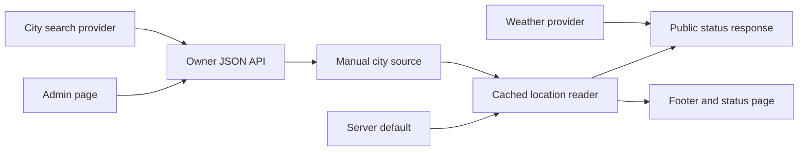

# Status data and admin

The footer and `/status` show the owner's chosen city, its local time, and
current weather. Both use the same status component and cached reader, so a
saved city has one public source. The footer links to the status page, which
uses the shared top bar and animated footer. During navigation, the component
pairs the city, clock, weather graphic, and temperature, with a reduced-motion
fallback.

## Public response

`GET /api/status` returns the city, region, country, IANA timezone, location
update time, and current weather. It never returns coordinates. The timezone
identifies the city's clock rules; the city-center coordinates remain on the
server for weather lookup.

Las Vegas is the server default until the owner saves a manual city. If a
configured database fails, the API returns 503 rather than publishing the
default. A storage failure should not look like a deliberate change of city.

## Owner authentication

### Access checks at the edge and inside the Worker

`/admin/status` uses the shared App Router layout, top bar, footer, and theme
controls. Its React editor reads and writes JSON through `/api/admin/status`.
Both paths use the same Cloudflare Access application as the [private writing
preview](../../guides/publishing/private-writing.md).

Access supplies a signed identity token, or JWT. On every read and write, the
Worker independently verifies its signature, issuer, audience, expiry, and owner
email. This check also applies on the direct `workers.dev` address, where a
request could otherwise avoid the custom domain's edge policy. Every write
checks the request origin as well. Admin responses disable caching and framing;
there is no separate site code or database login session.

### Required configuration

Set `OWNER_ACCESS_ISSUER`, `OWNER_ACCESS_AUDIENCE`, and `OWNER_ACCESS_EMAIL` as
production Worker secrets. The audience is the Access application's AUD tag; the
email identifies the allowed owner. Configure these Access destinations:

- `willie.page/admin` and `willie.page/admin/*` protect the admin pages.
- `willie.page/api/admin/*` protects their API requests.

Apply `lib/db/migrations/010_status.sql` before using the editor. The owner API
stays disabled if its Access configuration or database is absent. Check both
when diagnosing an unavailable editor rather than introducing a separate login.

## City selection

Choose “Edit” and type a city. Suggestions come from [Open-Meteo
geocoding](https://open-meteo.com/en/docs/geocoding-api), which turns a place
name into a city record. Selecting a result updates its city and region. Cancel
or Escape restores the saved city; a failed search also preserves it.

The saved coordinates describe the city center, not a device location. The
editor does not request browser geolocation. They exist to look up weather for
the selected city, while the public response withholds them.

## Caching and refresh

Several caches participate in the display. The shared location reader avoids
repeated database work, weather has its own freshness interval, and the client
refreshes a page that may already have been prefetched. Changing one interval
does not replace the others.

### Saved location and database reads

Next's shared data cache retains location reads for three hours. Saving a city
immediately invalidates its location tag. The PostgreSQL query also includes a
volatile timestamp so Hyperdrive, the database connection and query-cache layer,
cannot return a pre-save result from its separate cache. Hyperdrive does not
invalidate cached reads after writes; clearing the Next tag alone would leave
that second source of stale data.

API responses use `no-store`, preventing the browser from adding another cache
on top of the tagged server snapshot.

### Weather and the prerendered page

Weather fetches revalidate after 15 minutes. Observations older than an hour are
omitted. `/status` is prerendered with a 15-minute revalidation interval;
background refresh preserves its composition instead of replacing the page with
a loading screen.

Server HTML includes the city and weather without JavaScript. Hydration, when
the browser activates the interactive interface, adds the ticking clock,
timezone choices, and temperature conversion. Calculate local time from the IANA
timezone rather than caching a clock string: the city can remain unchanged while
its clock needs to advance.

### Client refresh and failure states

The client refreshes the snapshot every 15 minutes and when the visitor returns
to the tab. It also refreshes on hydration, because the page can be prefetched
for five minutes and may already contain an older city when opened. A failed
refresh keeps the last usable content.

When weather is missing, a refresh shows a local pending label until the request
settles. Existing weather stays visible during refresh. Only a completed
unsuccessful read shows the unavailable label. Without JavaScript, the
missing-weather fallback remains available; it must not become an indefinite
loading message.

## Future location sources

`LocationSource.read()` is the adapter interface for a city snapshot. Docket
sync is not implemented. A future adapter must convert private beacon positions
to a city before this boundary; exact-location storage belongs to Docket rather
than these public-site tables.

Before connecting an adapter, define its authentication, stale-beacon handling,
and explicit source-selection policy. It must not overwrite a manual choice
implicitly. Being able to read a beacon does not make it the owner's chosen
public status.

## Verification

Run `pnpm exec tsx --test tests/unit/status/*.test.mts
tests/unit/owner/owner-access.test.mts` for signed identity, origin, city validation,
and source fallback checks. The standard test command includes these checks. Use
a separate database for local integration checks, never production credentials
for test city changes.
