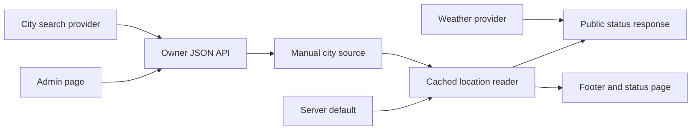

# Status data and admin

This guide is for the site maintainer configuring the status source or adding
Docket sync. The footer links to `/status`. Both use the same status component
and cached city and weather reader. The public page uses the shared top bar
and animated footer. The component pairs city, clock, weather graphic, and
temperature during navigation, with a reduced-motion fallback.

`GET /api/status` returns city, region, country, IANA timezone, location update
time, and current weather. It never returns coordinates. Las Vegas is the
server default until the owner saves a manual city. A configured database error
returns 503 instead of silently publishing the default city.

`/admin/status` renders through the shared App Router layout, top bar, footer,
and theme controls. Its React editor reads and writes JSON through
`/api/admin/status`. Both paths are protected by the same Cloudflare Access
application as the private writing preview. The Worker independently verifies
the signed Access JWT, issuer, audience, expiry, and owner email on every read
and write, so a direct `workers.dev` request cannot bypass the edge policy.
Every write also checks the request origin. Admin responses disable caching
and framing. There is no separate site code or database login session.

Set `OWNER_ACCESS_ISSUER`, `OWNER_ACCESS_AUDIENCE`, and `OWNER_ACCESS_EMAIL` as
production Worker secrets, and configure Access destinations for
`willie.page/admin`, `willie.page/admin/*`, and
`willie.page/api/admin/*`. The first two protect the page, while the third
protects API calls. `OWNER_ACCESS_AUDIENCE` is the Access application's AUD
tag. Apply `lib/db/migrations/010_status.sql` before using the editor. The
owner API stays disabled when its Access configuration or database is absent.

Choose “Edit” and type a city. Suggestions appear as you type. Selecting a
result updates the city and region. Cancel or Escape restores the saved city.
Search uses [Open-Meteo geocoding](https://open-meteo.com/en/docs/geocoding-api).
The stored coordinates describe the selected city center. They are for weather
lookup and are not a device location. The editor does not request browser
geolocation. Search failure preserves the saved city.

The server caches the location in Next's shared data cache for three hours.
Saving manually invalidates the location tag immediately. The location query
includes a volatile PostgreSQL timestamp so Hyperdrive does not return a
pre-save value from its separate query cache. This matters because Hyperdrive
does not invalidate cached reads after writes. Weather fetches revalidate after
15 minutes and observations older than one hour are omitted. The `/status`
page is prerendered with a 15-minute revalidation interval. Background
revalidation preserves the composition instead of showing a page-wide loading
screen. Server HTML includes the city and weather without JavaScript;
hydration adds the ticking clock, timezone choices, and temperature
conversion. The client refreshes the snapshot every 15 minutes and when the
visitor returns to the tab while keeping the last usable content on failure.
The page can be prefetched for five minutes; hydration also refreshes the
snapshot so returning to a prefetched page does not retain an old city. API
responses use no-store so the browser does not add another cache on top of the
tagged server snapshot. The UI should calculate local time from the IANA
timezone rather than caching a clock string. When no usable weather is present, a
refresh shows a local pending label until the request settles. Existing weather
stays visible during refreshes. Only a completed unsuccessful read shows the
unavailable label. Without JavaScript, the missing-weather fallback remains
available instead of displaying an indefinite loading message.

The component diagram shows the current data boundary:

`LocationSource.read()` is the adapter contract for a city snapshot. Docket
sync is not implemented. A future adapter must convert private beacon positions
to a city before this boundary. It must define authentication, stale-beacon
handling, and an explicit source selection policy. It must not overwrite a
manual choice implicitly. Exact-location storage belongs to Docket rather than
these public-site tables.

Run `pnpm exec tsx --test tests/unit/status*.test.mts tests/unit/owner-access.test.mts`
for signed identity, origin, city validation, and source fallback checks. The standard test command
includes these checks. Use a separate database for local integration checks.
Do not use production credentials for test city changes.
