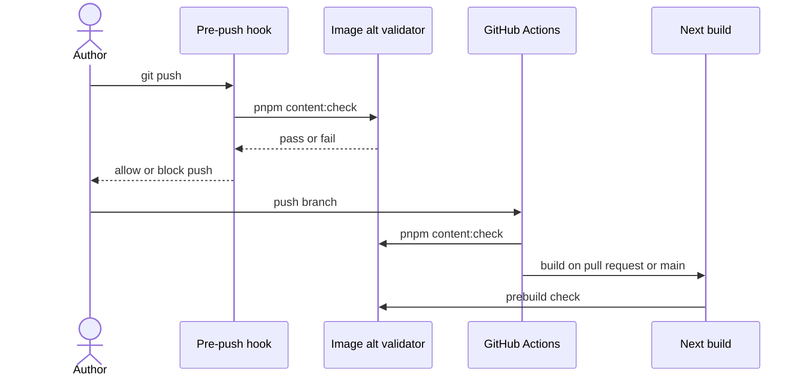

# Accessibility contract

The site targets WCAG 2.2 AA alongside the color and motion rules in the
[design principles](../../concepts/design/design-principles.md). Describe
meaningful content images before pushing or publishing them, and run
`pnpm content:check` after editing MDX or image markup.

The automated image check catches missing descriptions before content reaches
a reader. It cannot judge whether a description conveys the useful part of a
photo or whether a control makes sense. Review those questions on the page,
where the surrounding text and interaction give them meaning.

## Image descriptions

### Choose by the image's role on the page

An image needs nonblank alt text when it adds information: a writing's photo,
a project screenshot, a map, or an illustration that carries part of an
argument. Start by asking what the surrounding passage asks the reader to
notice. A scene-setting photo might need “A bus turning onto Maryland Parkway
at dusk.” If the passage instead discusses a stop's access, the useful details
would concern the stop and its surroundings. “Bus photo” would leave either
reader with almost nothing.

For a screenshot, describe the interaction or result that makes it relevant to
the text. A nonblank description satisfies the validator, but its usefulness
depends on whether it conveys that information.

Decoration has a different contract. Initiative cover motifs repeat nearby
titles and themes, so their frontmatter uses `decorative: true` with `alt: ''`.
Decorative JSX or MDX images use literal `alt=""` with `aria-hidden="true"`.
Markdown's empty `` does not mark decoration explicitly enough and fails
the check. The explicit marker makes omission a reviewable choice instead of
leaving a maintainer to guess whether the author forgot a description.

Classify the image in its particular use, rather than classifying the asset
once for every possible page. The same screenshot may supply evidence in a
project article and merely repeat a nearby destination title in a preview.
The surrounding content determines what its alternative must communicate.

### What source validation can establish

The validator rejects missing alt attributes, blank descriptions, and dynamic
JSX expressions that can resolve to an empty string. It includes drafts: a
future publication should not discover its missing descriptions only when the
author changes the publication state. Dynamic descriptions still need browser
review because source analysis cannot prove what every runtime value says.

The policy is shared through `lib/accessibility/alt-policy.ts`. Changing an
image's syntax to evade the check leaves the same reader problem in place;
correct the description or explicitly classify the image as decorative.

### Micropub accepts described photo objects

An author can publish a photo through a Micropub client instead of editing MDX.
That route still needs the description before the post is written. Micropub
therefore accepts photos as JSON objects with a URL in `value` and a nonblank
`alt`; the object keeps the image and its description together.

Upload the file to `/micropub/media` first, then include the returned URL and
description in the post. A bare URL, form photo field, or multipart photo file
receives `400 invalid_request` before any content write or GitHub commit. The
rejection leaves the author able to add the missing description before the
photo becomes published content, rather than requiring a repair afterward.

### The same gate runs at multiple boundaries

A repository edit passes through several checks on its way to a build. The
pre-push hook catches missing descriptions locally, while CI and prebuild
checks cover the path even when that hook was skipped. The sequence below
shows where each check runs.

The pre-push hook catches an omission while it is still local. CI checks every
branch push, and the build's prebuild step runs the validator again. Micropub
applies the same description policy before writing a post, covering the
authoring path that bypasses a local checkout.

## Interaction rules

### Give controls the semantics of their action

Use links for destinations and buttons for local actions. Every in-site link
uses `SiteLink` under [the link contract](./links.md); the contents list uses
fragment links. A destination must remain available without hover or a script
that intercepts a click. Correct semantics also let the browser supply familiar
behavior, such as opening a destination in another tab.

The homepage's Focuses controls let a visitor explore a focus temporarily or
pin it as a selection. Their pressed state reports only the pinned selection.
Passing the pointer over one expresses temporary interest; reporting it as
pressed would tell assistive technology that the visitor had made a choice
before they had.

### Preserve a useful focus path

When a visitor opens a dialog or an action popover, keyboard focus follows the
new content. Popovers focus their first action; both kinds of temporary view
return focus to their opener when dismissed. The visitor can then continue
from the place they left, instead of tabbing through the page to find it again.
The [link preview](./links.md#behaviour-and-accessibility) is different: it
repeats destination information, contains no action, and does not take focus.

Collapsed footer controls stay out of the tab order. An invisible control is
still an interruption if a keyboard user can land on it. Check both the open
and collapsed states when changing that region; a useful expanded footer does
not excuse an unusable collapsed one.

### Keep targets and boundaries perceptible

The studio pager has 24px hit targets while its dots keep their original size.
The visible mark and the area that accepts a press can differ: enlarging the
hit area makes a small visual control easier to operate without turning every
dot into a large graphic.

Forced colors get visible outlines and boundaries. Reduced motion removes
decorative transitions. Review the resulting state itself, including focus and
selection, because a motion effect or a background color must not be the only
way to recognize an action or its result.

## Evidence and limits

### Recorded checks on 28 September 2026

The production build passed the image check on 28 September 2026. Unit tests
covered missing and whitespace alt text, drafts, decorative images, galleries,
JSX, and Micropub rejection. That record establishes the gate's behavior in the
checked revision; it is not a fresh audit of every later change.

Chromium axe checks covered the homepage, writings, initiatives, search, brand,
404 and 500 pages, the IndieAuth fallback, the open command palette, and the
open homepage detail view. Keyboard checks covered dialog focus return, the
feed popover, the footer, Focuses, and the pager at desktop and phone widths.
A 320px reflow check and forced-color and reduced-motion checks passed.

Safari's accessibility tree exposed the homepage controls and dialog labels,
and Escape returned focus to the opening link. This provides evidence about
labels and focus behavior in that browser; it does not record what VoiceOver
actually spoke.

### Checks the record does not contain

No public writing or initiative detail page was available in that acceptance
environment because its content was draft. The authenticated IndieAuth consent
screen and a successful Micropub publish still needed a configured acceptance
environment. VoiceOver's spoken announcements were not captured by the
available browser tooling, so a person must check them before claiming a
complete manual screen-reader review.

A later review can close these gaps by checking the published detail pages,
completing the authenticated flows, and listening to VoiceOver. Until those
results are recorded, cite the 28 September checks with their original scope.
