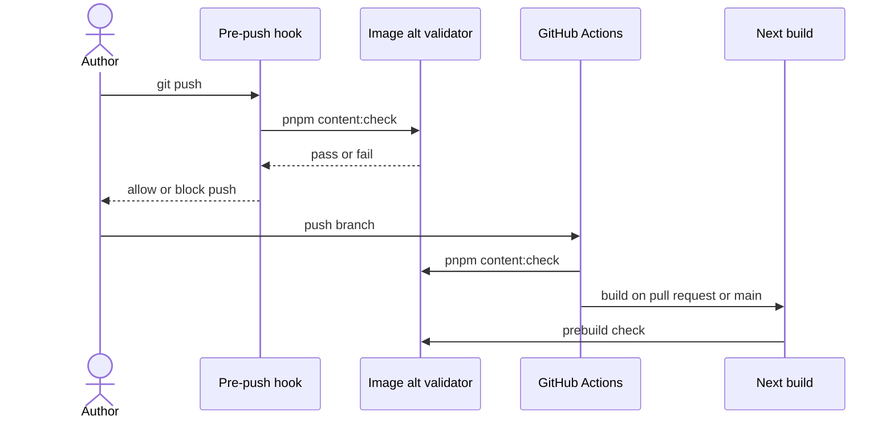

# Accessibility contract

The site targets WCAG 2.2 AA alongside the color and motion rules in the
[design principles](../../concepts/design/design-principles.md). Describe
meaningful content images before pushing or publishing them, and run
`pnpm content:check` after editing MDX or image markup.

The image gate checks a specific part of that contract. It prevents content
without an explicit description policy from entering the site; it does not
establish that a description is useful, a control is understandable, or a whole
page is accessible. Those questions still require review in context.

## Image descriptions

### Choose by the image's role on the page

An image needs nonblank alt text when it adds information: a writing's photo,
a project screenshot, a map, or an illustration that carries part of an
argument. Describe the information a reader would lose without seeing it.
“A bus turning onto Maryland Parkway at dusk” gives the reader a scene;
“Bus photo” mostly repeats the image's file type. For a screenshot, explain the
interaction or result that makes the screenshot relevant to the surrounding
text. A description that passes a nonblank check can still fail that task.

Decoration has a different contract. Initiative cover motifs repeat nearby
titles and themes, so their frontmatter uses `decorative: true` with `alt: ''`.
Decorative JSX or MDX images use literal `alt=""` with `aria-hidden="true"`.
Markdown's empty `` does not mark decoration explicitly enough and fails
the check. The explicit marker makes omission a reviewable choice instead of
leaving a maintainer to guess whether the author forgot a description.

Classify the image in its particular use, rather than classifying the asset
once for every possible page. The same screenshot may supply evidence in a
project article and merely repeat a nearby destination title in a preview.
The surrounding content determines what its alternative must communicate.

### What source validation can establish

The validator rejects missing alt attributes, blank descriptions, and dynamic
JSX expressions that can resolve to an empty string. It includes drafts: a
future publication should not discover its missing descriptions only when the
author changes the publication state. Dynamic descriptions still need browser
review because source analysis cannot prove what every runtime value says.

The policy is shared through `lib/accessibility/alt-policy.ts`. Changing an
image's syntax to evade the check leaves the same reader problem in place;
correct the description or explicitly classify the image as decorative.

### Micropub accepts described photo objects

Micropub photo posts require JSON photo objects with `value` and nonblank
`alt`. Upload files to `/micropub/media` first, then include their URLs and
descriptions in the post. A bare URL, form photo field, or multipart photo
file receives `400 invalid_request` before any content write or GitHub commit.

This places the decision at the point where the author still has the photo and
its purpose in mind. Accepting an undescribed post and hoping to repair it
later would make the publication path weaker than the repository path.

### The same gate runs at multiple boundaries

The local hook catches an omission before the push. A hook can be skipped, so
CI checks every branch push and the build checks again. Micropub applies the
same description policy before writing a post. These repeated boundaries cover
different entry paths; none replaces an author's judgment about meaning.

## Interaction rules

### Give controls the semantics of their action

Use links for destinations and buttons for local actions. Every in-site link
uses `SiteLink` under [the link contract](./links.md); the contents list uses
fragment links. A destination must remain available without hover or a script
that intercepts a click. Correct semantics also let the browser supply familiar
behavior, such as opening a destination in another tab.

The homepage Focuses buttons report pressed only when a visitor pins a focus.
Passing the pointer over a focus is temporary interest, not a selection. If the
pressed state followed hover, assistive technology would describe a choice the
visitor had never made.

### Preserve a useful focus path

Dialogs return focus to their opener. Popovers focus their first action and
return focus when dismissed. These rules give the visitor a place to continue
after inspecting temporary content, instead of sending them back through the
page to find their previous position.

Collapsed footer controls stay out of the tab order. An invisible control is
still an interruption if a keyboard user can land on it. Check both the open
and collapsed states when changing that region; a useful expanded footer does
not excuse an unusable collapsed one.

### Keep targets and boundaries perceptible

The studio pager has 24px hit targets while its dots keep their original size.
The visible mark and the area that accepts a press can differ: enlarging the
hit area makes a small visual control easier to operate without turning every
dot into a large graphic.

Forced colors get visible outlines and boundaries. Reduced motion removes
decorative transitions. Review the resulting state itself, including focus and
selection, because a motion effect or a background color must not be the only
way to recognize an action or its result.

## Evidence and limits

### Recorded checks on 28 September 2026

The production build passed the image check on 28 September 2026. Unit tests
covered missing and whitespace alt text, drafts, decorative images, galleries,
JSX, and Micropub rejection. That record establishes the gate's behavior in the
checked revision; it is not a fresh audit of every later change.

Chromium axe checks covered the homepage, writings, initiatives, search, brand,
404 and 500 pages, the IndieAuth fallback, the open command palette, and the
open homepage detail view. Keyboard checks covered dialog focus return, the
feed popover, the footer, Focuses, and the pager at desktop and phone widths.
A 320px reflow check and forced-color and reduced-motion checks passed.

Safari's accessibility tree exposed the homepage controls and dialog labels,
and Escape returned focus to the opening link. This provides evidence about
labels and focus behavior in that browser; it does not record what VoiceOver
actually spoke.

### Checks the record does not contain

No public writing or initiative detail page was available in that acceptance
environment because its content was draft. The authenticated IndieAuth consent
screen and a successful Micropub publish still needed a configured acceptance
environment. VoiceOver's spoken announcements were not captured by the
available browser tooling, so a person must check them before claiming a
complete manual screen-reader review.

Keep these boundaries attached to any report that cites the checks. Passing
source validation remains useful evidence for the image gate, but it cannot
fill in an unvisited page, an authenticated flow, or an uncaptured announcement.
