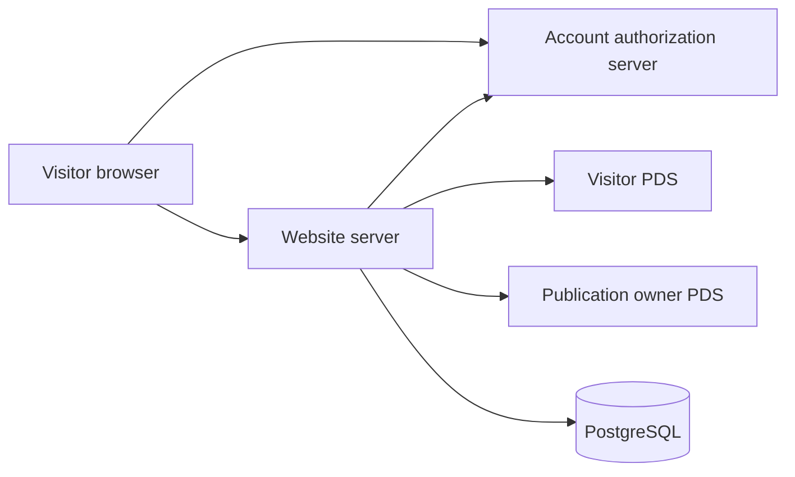
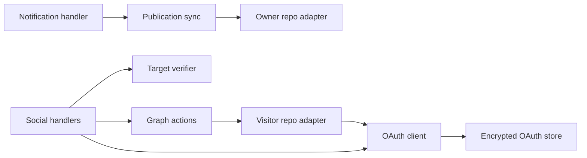
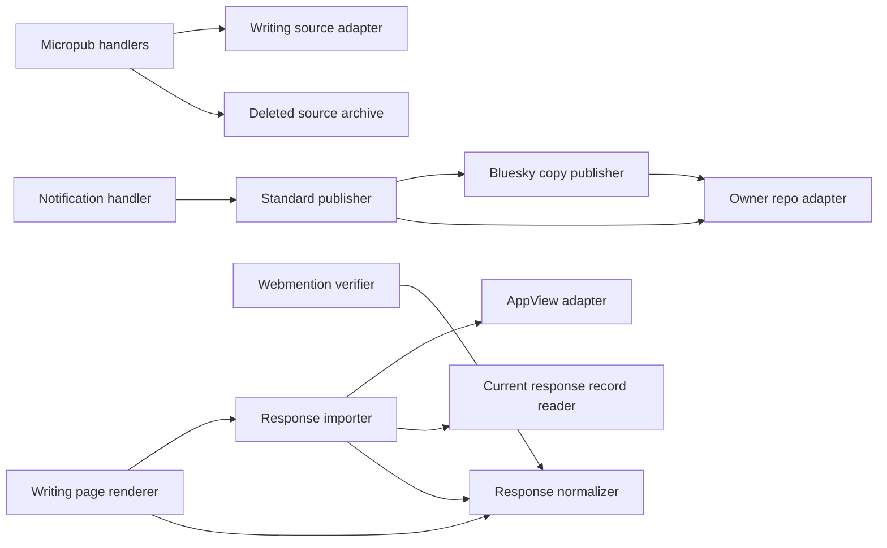

# AT Protocol

Standard.site describes the site as a publication and each published writing as
a document. The site writes those records to the owner's personal data server
(PDS), the service that stores the account's records. Visitors use their own
accounts to subscribe to the publication or recommend a writing.

Those two paths have different permissions. The owner's publishing credential
can change the publication; a visitor's authorization lets the site change only
the visitor's permitted social records. The visitor scope is
`atproto include:site.standard.authSocial`, as defined by [Standard.site
permissions](https://standard.site/docs/permissions/).

This reference describes configuration, record identity, and the behavior of the
public controls. Use the [verification guide](../../guides/publishing/publishing-verification.md)
for a hosted acceptance run and the [conformance record](publishing-conformance.md)
for dated results.

## Configuration

### Stable identity and configuration

An account's DID is its persistent identifier; its display handle can change.
A record key identifies one record within that account and collection. Production
is configured with owner DID `did:plc:iyn6nc3ffqm2e3555exyrgvv` and publication
key `3mwxne5td6lid`. Together they determine the publication's AT-URI, its address
in the owner's repository. Keep both stable so subscriptions continue to identify
the same publication.

Document keys are time-based identifiers (TIDs) derived from the writing rather
than assigned during a sync. Their construction is described under [Document
keys and media identity](#document-keys-and-media-identity).

| Variable                       | Purpose                                                                                                                                                                                                         |
| ------------------------------ | --------------------------------------------------------------------------------------------------------------------------------------------------------------------------------------------------------------- |
| `NEXT_PUBLIC_SITE_ORIGIN`      | Public origin; production defaults to `https://willie.page`. Isolated deployments must set their own origin.                                                                                                    |
| `NEXT_PUBLIC_ATPROTO_DID`      | Publication owner and public DID discovery.                                                                                                                                                                     |
| `NEXT_PUBLIC_BLUESKY_HANDLE`   | Display handle; profile links use the DID.                                                                                                                                                                      |
| `ATPROTO_PUBLICATION_RKEY`     | Publication TID generated once.                                                                                                                                                                                 |
| `ATPROTO_PUBLICATION_SETTINGS` | JSON self-labels and `preferences.showInDiscover`; omitted values preserve existing records.                                                                                                                    |
| `BLUESKY_APPVIEW_URL`          | Public AppView origin; defaults to `https://public.api.bsky.app`.                                                                                                                                               |
| `ATPROTO_APP_PASSWORD`         | Sensitive server publishing password; preview must use its own isolated account.                                                                                                                                |
| `ATPROTO_OAUTH_JWK`            | Private ES256 signing JWK with a unique `kid`; sensitive server variable.                                                                                                                                       |
| `ATPROTO_OAUTH_STORAGE_KEY`    | Base64 encoding of 32 random bytes for credential encryption; sensitive server variable.                                                                                                                        |
| `POSTGRES_URL`                 | Direct local Neon URL; Cloudflare Workers use Hyperdrive for durable OAuth and browser sessions. Migration `005_atproto_oauth.sql` and response migration `008_atproto_response_observations.sql` are required. |
| `INDIEWEB_NOTIFY_SECRET`       | Sensitive bearer secret shared with GitHub `INDIEWEB_NOTIFY_SECRET_PRODUCTION`.                                                                                                                                 |

### Credential boundaries and rotation

OAuth uses two different keys here. The signing key identifies this website as
an authorization client; the storage key encrypts the authorization state and
provider credentials retained in PostgreSQL. Both differ between production and
acceptance. Copying a production key into a preview would erase that separation.

The signing key is stored as a JSON Web Key (JWK); its `kid` identifies it in the
public JSON Web Key Set (JWKS). Generate it with
`generateClientAssertionKey(kid, 'ES256')` from `@atcute/oauth-node-client`.
Generate the storage key with `randomBytes(32).toString('base64')` from
`node:crypto`. Keep the values off command lines and out of Git.

Rotation has consequences for existing sessions. Replacing the storage key makes
the encrypted sessions and pending authorization state unreadable. Signing-key
rotation needs a planned overlap in the public JWKS, but the current single-key
configuration does not retain old signing keys. Plan that transition before
replacing the configured key.

### Configure the selected Worker

The source of truth for Worker names and bindings is `cloudflare.config.ts`.
Production is `willie-page`; preview is `willie-page-preview`, with separate
Hyperdrive, cache, and media bindings. `lib/db/postgres.ts` connects through
Hyperdrive in Workers and uses a direct `POSTGRES_URL` outside Cloudflare.
The OAuth signing and storage keys remain separate from the owner's publishing
app password.

Create the publishing password in the intended account and install it through
the secret procedure in the [deployment guide](../../guides/operations/deploy.md).
The current deploy scripts use `cf`; the removed Vercel setup script is not a
configuration path. Keep the secret out of shell arguments and source files.
Preview must never receive the production publisher's credential.

Verify the account's DID and handle, deploy the checked revision, then inspect
both the stored publication and public discovery. A configured secret name does
not establish that the credential can write. The production notification workflow
provides a required-sync result only after the canonical origin serves the exact
revision.

## Publishing

### Require the deployed revision

The production notification workflow runs on pushes to `main` and on manual
dispatch. It polls the canonical Cloudflare origin until `/api/indieweb/revision`
reports the exact Git SHA, then sends `atprotoRequired: true` to
`/api/indieweb/notify`. Publishing before that revision is live could associate a
record with a permalink still serving the previous deployment.

In required mode, HTTP 200 means publishing reported `synced`. Missing credentials
and skipped syncs fail the workflow. The configured workflow currently targets
production only; it does not automatically notify an isolated acceptance branch.
A preview or acceptance test must establish its own authorized trigger and keep
its account, database, and public origin separate.

### Build records and preserve extensions

The sync reads uncached published writings and constructs the publication and
document records. It validates them before applying changes in batches of 200,
leaves unchanged records alone on repeated runs, and preserves records belonging
to other publications. Drafts never produce documents.

Each document includes metadata and full plain text in `textContent`. Authors may
also supply typed `content` and `links` extensions in frontmatter. These fields
use a union: the object's `$type` names the format of its payload. Known formats
receive their specific schema checks; other valid union members retain their
payload rather than being converted into a format the site invented.

Omitting an extension preserves an existing value. Setting it to `null` removes
it. This distinction matters during an edit: a client that does not understand
an extension can leave it untouched instead of accidentally deleting another
client's data.

### Document keys and media identity

The page and publisher independently derive the same document key from the
original publication time and a clock ID computed from its path. They can
therefore agree on the document's address before a sync runs, without storing a
separate slug-to-record lookup.

That convenience makes the inputs part of the external identity. Changing the
slug or original publication time gives the document a different key, moves its
record, and breaks references to the old address. Treat either edit as an
identity change, rather than assuming that an unchanged title means the external
document is unchanged.

Covers and icons are a separate concern. The publisher fetches them from the live
site, and each must remain under 1,000,000 bytes. If an image fetch fails, the
sync preserves the existing blob instead of replacing it with a missing image.

### Verify both sides of the association

A record that names a website is not sufficient proof that the website endorses
that record. The site and the owner's PDS must identify each other.

For a publication, the record's URL and
`/.well-known/site.standard.publication` must agree. For a document, the
record's publication and path must match the writing's
`<link rel="site.standard.document">` in its HTML head. The social handlers check
the PDS record and the live website before every write, following [Standard.site
verification](https://standard.site/docs/verification/). This also explains why a
locally valid document cannot enable a recommendation before its public page and
record are available.

## Visitor actions

### Confirmed actions and undo

Subscribe appears beside Writings. Recommend appears beneath a published
writing. Signed-out visitors enter their handle, authorize with their provider,
and return to the original action. The server completes that action before
showing Subscribed or Recommended. Clicking again undoes it.

The controls reflect the account's records, including matching records created
by other clients. Undo removes every match and preserves unrelated records;
otherwise the button could show an action as undone while another matching
record kept the subscription or recommendation active.

### Control sizing and subscription menu

The controls distinguish a confirmed action from an account menu. Subscribe
uses a small tonal button. Subscribe and Recommend both use a 40px
visible height and a 48px touch target. The subscription label and the
recommendation heart identify confirmed actions. The compact recommendation uses
a neutral surface-container-highest resting state and gains a
secondary-container fill after confirmation. It keeps its state in accessible
text and its tooltip.

Sign-in opens a native dialog so the form does not push the writing out of view.
The dialog restores focus on dismissal and supports Escape and backdrop clicks.

Signed-in visitors see a Material 3 Expressive split button on `/writings`. Its
leading half toggles the subscription, and its attached arrow opens a compact
Sign out dropdown. Both halves follow the [Material split-button interaction
specs](https://m3.material.io/components/split-button/specs): 4px inner corners
at rest, 12px on hover, keyboard focus, or press, and independent state layers.
The arrow shifts from optical alignment to the center, rounds, and rotates while
the dropdown is open. Presses preserve the button size. Disabled controls use
the surface color with separate container and content opacity. Motion respects
the reduced-motion setting.

Recommend remains a standalone button. Writing actions contain no account menu.
The public controls show no protocol branding, profiles, counters, or feed
controls.

### Reply destinations and responsive layout

Reply can lead to the site's Webmention form or to an existing Bluesky copy.
The second destination is useful only when the importer has verified that the
copy is current and visible; opening an unavailable copy would leave the visitor
without a place to reply.

On compact screens, Reply uses a small tonal split button when the response
importer verifies a current, visible Bluesky copy against its PDS. The main
Reply button opens the IndieWeb form, and a separate attached chevron opens the
IndieWeb and Bluesky destination menu. Both segments use the same sizing,
independent state layers, corner changes, and reduced-motion behavior as the
sharing split button. From 600px upward, both reply destinations appear as
full-label buttons and fill the available width without a dropdown.

Both reply
destinations use secondary-container/on-secondary-container. Share uses
primary/on-primary, while the inactive recommendation uses
surface-container-highest/on-surface-variant. These roles follow [Material color
pairing and emphasis](https://m3.material.io/styles/color/the-color-system)
instead of applying an accent fill to every action.

Drafts, deleted or moderated copies, and failed verification do not expose that
destination. The Bluesky option opens the existing copy so the visitor can reply
in their client; the site does not compose Bluesky replies. With no verified
copy, Reply via IndieWeb opens the Webmention form directly.

Native Share remains the leading sharing action; its attached arrow offers the
manual Bluesky and Threads destinations.

The action order is Recommend, Reply, then Share in both the visual layout and
keyboard focus order. Reply and Recommend remain separate buttons. The action
row uses the available width and wraps to two rows below 380px and between 600px
and 699px. Missing recommendation controls leave no empty slot.

The writings index uses the header search control. It has no second inline
search form.

### Loading, failure, and retry

The page exposes an action only when its target can be verified. A setup failure
is an operator problem; a failed visitor action needs feedback at the control
that initiated it. This keeps the writing readable while making retries findable.

Loading and unavailable targets add no controls to the page. The status endpoint
returns `ready: false` when a publication or document is unverified. The browser
also hides controls when the initial status request fails. Publisher setup
errors never appear beside the page title.

User-initiated failures change the same action button to Try again. A failed
Sign out stays in its dropdown. Rate limits temporarily disable the action, and
unavailable targets disable it without offering a useless retry.

Sign-in validation stays inside the handle field, and connection failures retry
through Continue. No separate message, banner, or notification appears on the
page. Pending actions name the operation, and only a confirmed response changes
the subscribed or recommended state.

### HTTP endpoints

| Endpoint                                   | Behavior                                                                                                                                        |
| ------------------------------------------ | ----------------------------------------------------------------------------------------------------------------------------------------------- |
| `GET /oauth-client-metadata.json`          | Confidential client metadata derived from the site origin.                                                                                      |
| `GET /.well-known/atproto-jwks.json`       | Public signing keys; private key material is never returned.                                                                                    |
| `POST /api/atproto/login`                  | Accepts handle, action and optional writing slug; JSON returns an authorization URL, native forms redirect. The server derives the return path. |
| `GET /atproto/callback`                    | Consumes browser-bound authorization state and completes the pending action.                                                                    |
| `POST /api/atproto/logout`                 | Deletes the current browser session. Other browser sessions remain signed in.                                                                   |
| `GET /api/atproto/social`                  | Returns sign-in and subscription state plus recommendation state when given `slug`.                                                             |
| `PUT / DELETE /api/atproto/subscription`   | Creates or removes the visitor's subscription.                                                                                                  |
| `PUT / DELETE /api/atproto/recommendation` | Creates or removes a recommendation for the published `slug` in the JSON body.                                                                  |

### Sessions, locks, and outbound requests

Tokens stay on the server. The browser receives an opaque session cookie with
HttpOnly, Secure, and SameSite=Lax attributes. Local HTTP omits Secure.
Authorization state expires after ten minutes and is consumed even when the
visitor cancels authorization. Browser sessions expire after 30 days. Encrypted
OAuth sessions have a 180-day storage limit; provider revocation or refresh
failure can end them sooner.

Mutations check Origin, require a browser session, validate targets, and apply
durable rate limits. Reads allow 60 requests per IP per minute. Login and writes
allow ten per minute per IP or account.

A provider can consume a refresh token before the site's later record write
succeeds. The database must retain the replacement credential even if that later
write fails, or the next request could try to reuse the spent token. PostgreSQL
transaction locks serialize refresh and writes across instances. Nested locks and credential stores reuse
the pinned connection to avoid exhausting the database pool.

An account can supply its own provider endpoints. The site treats those addresses
as untrusted: it uses public-only HTTPS sockets, rejects redirects, and caps
responses at 2 MiB.

The first diagram shows which services exchange requests. The second locates
those responsibilities in the server modules; the encrypted store belongs to the
OAuth client rather than to the browser controls.

## Verification

### Source and database checks

Run `pnpm test`, lint, type checking, and a production build on the revision
being reviewed. `pnpm test` runs the runtime preparation in `pretest` before the
bounded unit suite. Add `pnpm build:cloudflare` when checking the production
Worker package; use `pnpm build:cloudflare:preview` for the preview package.
Build each environment separately because its origin and revision are compiled
into the output.

`tests/integration/atproto/oauth.test.mts` exercises encrypted state expiry,
cancellation, callback replay, browser isolation, sign-out, and nested
distributed locks against an isolated acceptance database. Load acceptance
configuration into the process environment before running it with `tsx --test
--test-concurrency=1`. Never run fixture tests against the production database.

### Simulated browser checks

For browser fixtures, copy `tests/fixtures/indieweb/publishing.mdx` into
`content/writings/indieweb-acceptance.mdx`, build with isolated OAuth
configuration, and run `STANDARD_SOCIAL_FIXTURE=1 pnpm exec playwright test
tests/e2e/site/atproto/standard-site.spec.mts --project=desktop --workers=1`. The test uses
simulated provider responses and saves desktop and 390px screenshots under
`.playwright-mcp`. Remove the copied writing before a production build or
commit. These checks do not prove a live account-provider grant or real PDS
social write.

### External evidence and publication approval

The October 9 conformance record reports four authored drafts and no published
production writing. That observation leaves production document verification
waiting for the first approved publication; it is not a fresh inventory. The
[conformance matrix](publishing-conformance.md) records the dated external gates. Explicit
Bluesky copies and imported responses are implemented; public counts and a
reader remain outside this work.

## Authoring and Bluesky copies

### Typed authoring extensions

The `atproto` frontmatter object can supply `contributors`, `labels`, `content`,
`links`, and `bskyPostRef`. Typed union fields require objects whose `$type` names
a valid lexicon format. The builder checks known member schemas and retains
other valid typed payloads; it does not create a new Standard.site content format.

Suppose an author wants to keep the contributor attribution but remove a typed
content extension left by another editor. The frontmatter
`atproto: { contributors: [{ did: "did:plc:iyn6nc3ffqm2e3555exyrgvv", role:
"Author" }], content: null }` makes that removal explicit. The document still
contains readable `textContent`. Leaving `content` out would preserve the
existing extension instead.

### Explicit copies and retry recovery

Configuring a Bluesky account makes it a possible destination; it does not
announce every writing there. A writing requests a copy explicitly with
`syndicateTo: ["https://bsky.app/profile/<configured-owner-DID>"]`. Micropub
advertises that destination only when publishing credentials are configured.

The publisher creates the Standard.site document first, then includes strong
references to the document and publication in the announcement's external embed.
A strong reference names both a record's address and its content identifier
(CID), identifying the version being referenced. This associates the announcement
with the original rather than relying on text that happens to contain its URL.

The announcement uses the document's TID, so a retry can recover the same copy.
An existing manually linked copy or strong reference also prevents a duplicate.
Editing the writing updates its Standard.site record and leaves the announcement
text in place, preserving the conversation attached to it. Unpublishing removes
the document but preserves the Bluesky copy; removing the original is not a
promise that its outside announcement has disappeared.

### Discover through AppView, verify at the source

The public Bluesky AppView supplies the conversation around a linked copy:
replies, quotes, likes, and repost actors. It is an indexed view of account data,
while each author's PDS stores the source records. The importer uses both, for
different reasons.

Discovery starts with AppView and excludes hidden, blocked, unavailable, and
moderated posts before source reads. The importer then resolves each discovered
author's PDS and checks the current identity, reply or quote relationship,
content, and media. That second read can detect an edit even while AppView still
returns an older projection; it also removes deleted source records and applies
current self-labels.

Source reads verify candidates already admitted by discovery. They never add
candidates that bypass AppView moderation. The one-minute cache bounds how often
the site repeats this work; it does not make an older AppView projection the
authoritative current text.

### Bound response work and report incomplete results

A page cannot wait indefinitely for every responding author's server. Source
checks therefore use four workers and a shared 20-second deadline. Failed or
unverified source checks omit stale candidates and mark the result incomplete.
Matching records retain AppView media URLs. Changed records use their current
blob references with native controls. Legacy image and video references retain
their unknown sizes instead of inventing byte counts. Imported responses share
presentation with approved Webmentions but never become verified Webmention
rows. Canonical source identity prevents duplicate imported and Webmention responses.
The diagram shows those paths converging in response normalization while retaining
separate discovery and verification steps.

