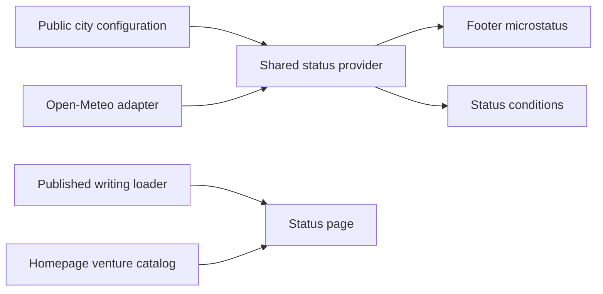

# Status

This page is for Willie and whoever adds sources to `/status`. Keep the footer
small, and add new information to the status page only when its source is
connected and its public meaning is clear.

## Prototype decision

The October 11, 2026 prototype adds one link beneath the footer tagline. It
does not change the collapsed homepage contact row. The existing footer
opening reveals the link and enables keyboard focus together. The expanded
page uses the site's type, colors, TopBar, and footer. It stacks below 600px.
The status page omits the footer microstatus to avoid repeating itself.

Las Vegas is the prototype city in `lib/status/model.ts`. Its coordinates
represent the city center. Willie must explicitly change that record when
he wants a different public city. This is not device tracking or a claim
that he is physically at those coordinates. The browser clock uses
America/Los_Angeles, including daylight saving changes.

## Sources

This component diagram shows the modules that supply the two surfaces.

`/api/status` fetches Open-Meteo on the server with a 3-second deadline.
Successful snapshots revalidate after 15 minutes. Failed responses are not
cached by the HTTP endpoint. The client shares one snapshot across the
footer and page, refreshes every 15 minutes while visible, and refreshes when
the tab becomes visible. Conditions older than 60 minutes are omitted.
The provider's timestamp determines age, not when the browser fetched it.

The site content supplies current work and the two latest published writings.
Draft writing never appears here, even in development. These dates are
publication dates, not inferred claims about what Willie is doing today.

Future adapters should return only selected public fields and their source
timestamps. Each section must fail independently. Never turn music playback,
calendar events, or commits into an availability claim. Keep credentials on
the server and omit unconnected sections. Do not add a generic integration
framework before a second external source needs it.

## Release boundary

This is a local prototype, not a deployment. Open-Meteo's free hosted API is
for noncommercial use and requires attribution. Recheck the site's eligibility
at [Open-Meteo pricing](https://open-meteo.com/en/pricing) before release.
The public city and any future personal update still need Willie's choice.
