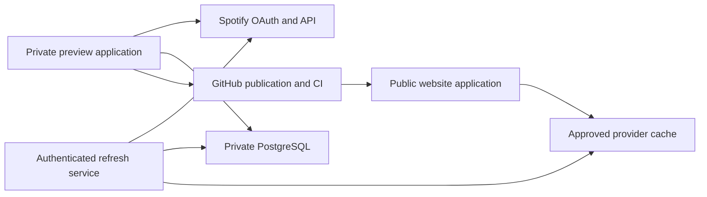

# Music production launch plan

> **For agentic workers:** Use `superpowers:executing-plans` to implement this plan task by task. Do not treat an unchecked gate as complete.

**Reader:** The engineer finishing Music. Implement and verify the complete admin-to-public workflow before deploying it as usable.

**Goal:** Willie opens the admin portal, connects Spotify, curates playlists, reviews a saved revision, and publishes a verified public gallery without terminal work.

**Architecture:** Extend the protected preview studio with a Music-specific catalog and provider store. Reuse the reviewed gallery for private review and public rendering. Publish only an approved catalog through the protected GitHub pipeline; cache provider data separately from editorial revisions.

**Tech stack:** Next.js 16, React 19, PostgreSQL, Spotify OAuth/Web API, Cloudflare Access, GitHub protected PRs, Vercel for the private studio, and Cloudflare Workers for the public site.

## Audit baseline

The October 12 audit found Music was **not deployable as a working feature**.
The October 13 implementation now includes production routes, persistence,
Spotify OAuth, the approved cache, and recoverable publication. Local checks
have passed; hosted acceptance below remains required. The old prototype
screens used fictional content, a simulated connection, and browser-local
drafts. Those fixtures are not used by the production Music routes.

At 13:20 PDT on October 13, the private `preview.willie.page` studio was open
in Willie's personal Chrome profile behind Cloudflare Access. Spotify consent
worked, and the hosted studio imported 466 real public playlists. All remain
unselected. The deployed studio is older than the current Music branch and
still has a separate search field. A private exact-head deployment was ready
for the former PR head, but Vercel then refused private Production promotion
because the account reached its 100-deployment daily limit. Do not retry a
deployment until fresh quota evidence shows capacity.

The Music branch is rebased onto `origin/main` at `ab02f13`. Its shared
palette and lost-import-response recovery are local, not hosted. PR
[#221](https://github.com/WillieCubed/website/pull/221) passed the required
`ci` check at the earlier head `5949371`. The Cloudflare refresh fix needs a
new CI run, and its private Vercel deployment remains rate limited. A newer
private Production deployment belongs to another branch and does not prove
this Music build. Main now serves
`willie.page` from Cloudflare Workers. The public Music route has a local
Worker build but still needs a hosted deployment, public database schema,
approved catalog, and hosted checks. The
owner must choose what belongs in the collection before publication. Do not
turn a test fixture or an agent's guess into his public catalog. The verified
Spotify grant imported 466 playlists; a client-token check alone would not
have established that access.
Credential checks did not print secret values, and their temporary file was
removed. See [the audit evidence](../../evidence/music-launch-readiness-20261012.json).

## Product contract

Willie's normal path is **Admin → Music → Connect Spotify → Choose playlists →
Preview → Curate → Review → Publish → Live**. Setup is skipped when an existing
connection and catalog are available. Returning opens the saved draft, with a
separate link to the live gallery. Connecting or importing publishes nothing.

Use `/admin` as the bookmarkable entry, redirecting to the protected
`https://preview.willie.page/studio`. Add Music at `/studio/music`; preserve
the existing writing workflow and `/admin/status`. Keep notes optional. Never
invent editorial text or import the fictional sample catalog into real storage.

The container diagram shows the deployed services and their data boundaries.

The public renderer reads the committed catalog and approved cache. It never
loads private revisions or tokens. The refresh service alone reads encrypted
provider credentials, and only a dedicated service credential can invoke it.

## Implementation order

### 1. Integrate the private foundation without losing existing work

Files: the foundation's `lib/studio/auth.ts`, `config.ts`, `oauth.ts`,
`publication.ts`, `proxy.ts`, and `app/studio/page.tsx`; new
`app/admin/page.tsx` and `app/studio/music/page.tsx`.

- [ ] Reconcile PR #201 with integrated main. Do not deploy the prototype branch as the private studio: it currently omits the writing implementation.
- [ ] Preserve the studio's signed Access JWT checks, owner binding, mutation-origin checks, and private response headers. Verify anonymous and direct-origin denial.
- [ ] Add the admin redirect and Music entry. Keep published-writing APIs and the writing library unchanged.
- [ ] Deploy the combined private implementation to its own preview first. Keep the private project's branch pinned until its implementation is integrated; switching it to public-only main removes the studio.
- [ ] Require hosted sign-in, writing save/reopen regression checks, and Music route access before moving on.

The Music work must not wait for unrelated widget-generation acceptance. Reuse
the auth and publication foundation while preserving the separate writing gates.

### 2. Build the Music model and durable storage

Create `lib/music/types.ts`, `schema.ts`, `store.ts`, `storage.ts`, a private
Music migration, and `scripts/music/migrate.mts`. Test in
`tests/unit/music-store.test.mts` and an isolated PostgreSQL integration.

- [ ] Define a versioned catalog with selected Spotify IDs, explicit order, optional feature, notes, and ordered series. Reject unknown fields, duplicate IDs, invalid membership, and a feature outside the selection.
- [ ] Use Music-specific tables for catalog heads, immutable revisions, OAuth states, encrypted connections, import/cache state, and publication receipts. Do not insert Music into the writing-only `DraftContent` schema.
- [ ] Save with an expected revision ID. Preserve both versions on conflict and leave the current head intact. Add history and recovery; rollback creates a new revision.
- [ ] Apply the private migration twice and read records back. Check migration names against current main and the foundation's separate migration runner before numbering them.
- [ ] Establish the separately readable approved provider cache. Public queries must not return private catalog order, excluded IDs, notes, or connections.

### 3. Replace simulated Spotify connection

Create `lib/music/spotify/oauth.ts`, `tokens.ts`, and `client.ts`, plus
`app/api/studio/music/spotify/connect/route.ts`, `callback/route.ts`, and a
connection-status endpoint. Test OAuth and token behavior independently.

- [ ] Configure the existing app keys on the private deployment as server-only secrets. Reuse `STUDIO_TOKEN_ENCRYPTION_KEY`; retain it across deployments.
- [ ] Register and verify the exact callback `https://preview.willie.page/api/studio/music/spotify/callback`. An unauthenticated redirect to Spotify login is not proof of callback registration.
- [ ] Verify the developer app's permitted owner account and current Spotify access requirements through a real user grant. Client-token success alone does not establish Development Mode eligibility or playlist access.
- [ ] Implement authorization code flow with PKCE, one-use owner-bound state, expiry, and a same-site callback cookie. Reject missing/replayed state, wrong-owner callbacks, and cancelled consent without destroying a working connection.
- [ ] Request playlist read access only. Validate the connected Spotify ID and bind it to the authorized site owner. Encrypt access and refresh tokens in private storage.
- [ ] Refresh expired access tokens under a single-writer lock. Retain a previous refresh token when Spotify omits its replacement. Expose reconnect on revocation or `invalid_grant`, without losing curation.
- [ ] Exercise real consent, `/me`, `/me/playlists`, refresh, cancellation, and reconnect on the hosted admin. Remove all simulated success paths from production code.

Spotify requires current-user playlist access and renamed playlist item fields.
Use `/me/playlists` and `/playlists/{id}/items`, including the current `item`
response field. Do not use the removed other-user listing or deprecated track
endpoint. [Spotify migration guide](https://developer.spotify.com/documentation/web-api/tutorials/february-2026-migration-guide).

Developer Dashboard refresh tokens expire after six months; refreshing access
does not extend that lifetime. Show reconnect when needed rather than promising
a permanent connection. [Spotify token lifecycle](https://developer.spotify.com/documentation/web-api/tutorials/refreshing-tokens).

### 4. Import and refresh real provider data

Create `lib/music/spotify/import.ts`, `lib/music/cache.ts`, and a protected
import endpoint. Add provider-response fixtures covering current field names.

- [ ] Paginate the entire library. Publish only playlists owned by the connected user with `public === true`. Keep excluded/ineligible records private and explain their state in the admin.
- [ ] Fetch original ordered items. Preserve duplicates, episodes, local/unavailable items, and null positions. Treat unknown durations as unknown; never fabricate runtime or modification dates.
- [ ] Read `snapshot_id` before and after item pagination. Retry a changed snapshot with a bound; never cache a mixed sequence as successful.
- [ ] Limit concurrent provider requests to two. Respect `Retry-After`, retain progress, and offer retry after incomplete imports or rate limits.
- [ ] Refresh metadata on an hourly target and items when their snapshot changes. Retain last-good data for at most 24 hours during transient errors. Suppress a record immediately after a successful check finds it private, deleted, or no longer owned.
- [ ] Keep new imports unselected and preserve editorial order, notes, feature, and series during refresh. A provider failure must not reset the catalog.

### 5. Connect the reviewed UI to real services

Refactor `components/prototypes/music/MusicPrototype.tsx` into production
`components/music` gallery, focus, setup, library, editor, and review units.
Keep the fictional fixture entry in the development-only prototype. Create
`app/api/studio/music/catalog/route.ts` and revision/history endpoints.

- [ ] Replace fixture IDs, sample tracks, generated covers, local apply, and disabled Spotify links with typed data and real service callbacks.
- [ ] Keep the current selection, single feature, grouped choices, ordered series, optional notes, shared-cover motion, and responsive focus behavior.
- [ ] Show loading, no playlists, no eligible playlists, missing artwork, import failure, expired connection, saving, saved, conflict, and offline recovery states. Keep errors beside their affected action.
- [ ] Autosave privately. Disable review/publish while a save is unresolved. Reload must recover the same revision; a later edit invalidates the reviewed revision.
- [ ] Use one renderer for the private gallery preview and public Music page. Preserve complete square artwork and provide Spotify attribution and working source navigation.
- [ ] Capture full 1440×1000 and 390×844 viewports for every iteration in both themes, plus 320px reflow and long-page companions. Inspect real long titles and missing artwork, not only samples.

### 6. Add the public gallery and approved-data boundary

Create `app/music/page.tsx`, `lib/music/public.ts`, a validated
`content/music/catalog.json`, and a public focused-playlist data route. Modify
navigation, `lib/search/collect.ts`, metadata, and the sitemap.

- [ ] Render only selected, eligible records from the approved projection. Reject private, excluded, unknown, and fixture IDs at public endpoints.
- [ ] Preserve `/music?series=...&detail=...`, direct entry, refresh, history, focus restoration, one optional feature, and explicit series order.
- [ ] Generate focused metadata from approved data, with `/music` canonical. Include Music in navigation, search, and the sitemap only when the real public route exists.
- [ ] Keep credentials and private storage out of client bundles, page data, search, feeds, sitemap, logs, social metadata, and error responses. Add isolation tests for each discovery path.
- [ ] Verify current Spotify artwork/source-link requirements before release. Configure only the image hosts actually returned by the provider. Preserve a readable fallback when an image fails.

### 7. Complete protected publication

Extract the foundation's GitHub proposal/check/merge/proof transport into a
typed adapter. Add `lib/music/publication.ts`, Music publication endpoints,
and a public revision-proof endpoint. Test retries and stale main in isolation.

- [ ] Bind review and approval to one saved immutable Music revision. Revalidate every selected playlist's eligibility immediately before publication.
- [ ] Export an allowlisted Music artifact at `content/music/catalog.json`. Reject writing paths, arbitrary files, private IDs, secrets, and sample records.
- [ ] Complete website-only publishing credential permissions: Contents and Pull requests read/write, plus Commit statuses and Checks read. Verify current permissions and a real Music publication; the foundation's old 403 must not remain a hidden failure.
- [ ] Create/recover the same publication PR, run required checks, and rebase merge through existing protections. Preserve the exact artifact during unrelated main updates. Stop on an artifact conflict instead of overwriting it.
- [ ] Show Publishing, Deploying, Failed with retry, and Live accurately. Live requires the selected revision ID, source blob hash, and deployed commit ancestry to match the public proof.
- [ ] Verify rollback by publishing a prior revision as a new reviewed publication. Do not bypass protected main or change its rules to make publishing work.

Git remains the editorial source of truth. A direct database publication was
rejected because it would introduce a second approval and rollback mechanism.
Music JSON does not run through writing MDX validation or widget compilation.

### 8. Provision refresh and release configuration

Create a scoped refresh-service endpoint, `.github/workflows/music-refresh.yml`,
and one idempotent Music provisioning/verification script.

- [ ] Inventory configuration separately on the public Cloudflare Worker and private Vercel studio. The public Worker must not inherit private studio state or `SITE_MODE=preview`.
- [ ] Set a dedicated refresh-service secret and the exact provider/store variables. Never use the publishing token as a refresh credential.
- [ ] Use the existing GitHub Actions scheduler for the hourly refresh target unless the verified hosting plan already supports hourly cron. Do not upgrade hosting or add a paid service silently.
- [ ] Restrict the refresh route to that service credential, approved IDs, and bounded work. Return status/counts only. Test invalid credentials and repeated jobs.
- [ ] Run migrations and deployment preflight through the provisioning script. Report safe configuration presence, provider status, schema status, and publication capability without printing credentials.
- [ ] Leave the scheduler disabled until the endpoint is deployed and authenticated invocation succeeds.

## Final hosted acceptance and rollout

- [ ] Rebase on integrated main, run unit/integration checks, lint, types, content checks, and both Next and Cloudflare production builds with bounded concurrency. Run browser projects with at most two workers. Re-run CI after pushing the rebased head.
- [ ] Verify the exact-head private Production deployment in Willie's authenticated personal Chrome profile. Confirm that the 466 imported playlists remain available without repeating consent.
- [ ] Have Willie choose playlists, the optional feature, and any series or notes. Reload and confirm the draft survives while the public gallery remains unchanged. Do not create editorial choices for him.
- [ ] Review one revision, edit again, and confirm the old approval cannot publish the newer draft. Exercise conflict recovery and a failed save.
- [ ] Publish an explicitly chosen real catalog. Verify the protected PR, CI, deployment, public revision proof, actual artwork, ordered tracks, source links, metadata, navigation, and search.
- [ ] Check anonymous public browsing, anonymous private denial, direct-origin denial, excluded-playlist denial, rate-limit retry, token expiry, and last-good cache expiry.
- [ ] Capture the real admin and public gallery in full desktop/phone viewports and both themes. Check keyboard operation, focus restoration, reduced motion, and screen-reader labels.
- [ ] Enable the scheduler, verify a real refresh, and verify rollback. Mark #44/#45 complete only after this hosted sequence passes.

No new visual decision is required from Willie to implement this plan. Spotify
consent and import are complete. His remaining product action is choosing
what to publish. The agent can finish code, CI, deployment, and verification
work around that choice without asking him to repeat setup.

About and Research remain outside this release. Deploying the current
prototype alone does not satisfy any of the hosted launch gates above.
